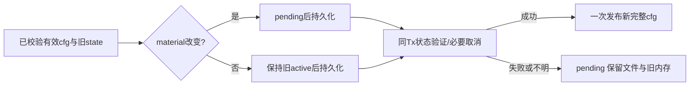

# 纯模型配置保存误暂停仓库读取：修正计划

2026-10-15，codex/sidebar-workflow，基线c1513d513e8124abad67aca773e31849558592aa。用户要求最佳实践优化、没想清楚先不实现；本次修正既有S3合同的实现偏差，不新增功能或启用生产绑定。完整REQ/AC、原生GitHub、启动/发布/恢复入口目标保持。

## F2事实与合同

现有activation.save对material未变化的保存，也在文件落盘后无条件设置pending，再校验DB并发布内存。其代次虽然不变，但运行ctx看见pending会拒绝下一HTTP/模型操作，可能误停正在进行的审计。先前模型/outbox测试只在Save返回后验证descriptor有效，没有覆盖commit→publish窗口；不能据此前测试宣称整个保存期间都不中断。

新增确定性反例TestCredentialModelOnlySaveKeepsReadersActiveBeforePublish：实际SQLite/Settings先完成初次激活，单独修改模型，在beforePublish钩子暂停；DBgeneration不变、旧模型内存尚未发布，但旧ctx被拒绝且下一真实GitLab SDK/httptest读取也被拦截。修复前实际运行exit1（/tmp/aimangebot-model-only-before.log），两个明确失败断言；无真实外部请求。

正确合同：material相同时保留旧active cfg/generation/epoch直到新完整配置一次发布，运行继续使用原冻结配置；material变化才在文件写前进入pending。持久化结果未知、DB失败、提交后发布失败依然必须pending并阻止后续保存，不能把此次修复变成失败放行。当前ACL/lease检查不变。

## Workflow / Maintainability Gate 与F3

P10窄修正，既有F2/S3确认需求不变。repository_credential_activation.go约200行，已分离持久化和DB状态；allowed narrow_fix，无需大重构。只移除未变凭据正常路径的短暂pending，并对activateAndPublish返回错误统一设置pending；不改model/git token指纹、DBcounter、epoch规则或startup绑定。

验证：保留上述已证明会失败的回归；补充纯模型保存的替换前失败、替换后失败、commit后发布失败，分别确认旧有效性/不覆盖文件/不半发布/代次不变。再跑activation/实际Runner/descriptor专项及race、完整Go、vet/build/typecheck。测试只用合成配置、临时库和httptest；旧CI终态后才推新生产提交。修正没有新增用户审批或不确定语义，按原已批准消费者合同实施。
