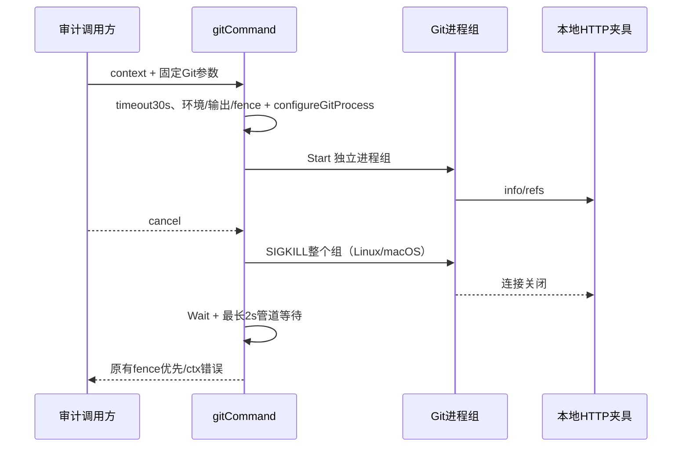

# Git 子进程取消修复方案

2026-10-16；codex/sidebar-workflow；F2/F3 narrow fix；输入为Confirmed requirements.md 的可靠性/固定PR审计约束、用户最佳实践优化及“没想清楚先不实现”。本片解决已经复现的现有Git执行退出问题，不开放native绑定或改变完整REQ/AC范围。

## Workflow Gate

- User request：最佳实践优化，并排查无法落地的实现。
- Detected phase：P8维护修复；原生factory仍在P6研究。
- Task type：后端进程生命周期缺陷修复。
- Required upstream：现有gitCommand、取消/凭据fence合同、实测反例、当前需求。
- Found：上述均存在；临时真实Git→阻塞回环HTTP测试，取消后1秒command_returned=false/upstream_canceled=false，主动断开fixture后退出，exit1。
- Missing：全native factory/预算/API双树diff仍未完成，但不是本修复依赖。
- Implementation allowed：仅本窄修复在技术评审Pass后允许；不允许启用factory。
- Prework：本方案与独立技术评审先提交推送。
- Execution scope：gitCommand进程初始化、平台小helper、真实Git取消/成功/父进程正常退出后管道继承回归；不改HTTP/API/UI/数据库。
- Acceptance：支持的Linux/macOS取消可结束同进程组的普通Git helper；命令/网络停止均可观察；context.Canceled保持；成功读取/凭据fence保持；管道等待有界。
- Risks：进程组不是sandbox，不保证终止主动setsid逃逸的恶意子进程；Windows和其他OS仅增加WaitDelay，不宣称树级取消。Git仓库代码不被执行的现有限制保留。

## Maintainability Gate

git_repository.go涵盖命令执行、Git内容读取和准备编排，具有多职责风险；只加一行委托，进程策略放独立git_process_{unix,other}.go，禁止向大文件堆平台分支。风险high（职责混合），allowed change=narrow_fix/adapter_extraction；无需先广泛重构。已有git_investigation/git_metadata/git_path_cache与fence测试，本片增独立进程测试；不移动既有业务路径。

## 当前与期望

exec.CommandContext默认只kill直接Git进程；使用自定义Writer时os/exec还需要等待继承输出管道的helper。现有gitCommand没有WaitDelay或进程组取消。阻塞info/refs的真实Git fetch可复现父调用未返回且上游请求继续。本片期望在取消/30秒命令超时后结束正常Git子进程链，避免占用worker与网络。

## 数据/字段与兼容

无新持久对象、schema、公共API、配置项或依赖。新增内部helper configureGitProcess(*exec.Cmd)，在cmd.Run之前调用：

| 对象/字段 | 改动 | 类型/必须 | 默认/owner | 校验与兼容 |
| --- | --- | --- | --- | --- |
| Cmd.WaitDelay | 新设置 | time.Duration/必须 | 2s，Git执行helper | 限制取消/主进程退出后的管道等待，不改变30s命令deadline |
| Cmd.SysProcAttr.Setpgid | Linux/macOS新设置 | bool/必须 | true，平台helper | 独立进程组；不继承宿主组，不更改Dir/Env/args |
| Cmd.Cancel | Linux/macOS替换 | func()error/必须 | kill(-PID,SIGKILL) | 无Process/PID<=1返回os.ErrProcessDone；ESRCH映射os.ErrProcessDone；其余错误返回 |

仅Linux/macOS实现组取消；其他平台保留CommandContext的直接进程kill，并统一WaitDelay。使用显式build tags保证源码互斥且可交叉编译；不引入未经验证的Windows taskkill或Job Object实现。不会把其他平台的网络helper退出声明为已验收。

## 数据流与生命周期

Cmd为每次调用创建的内存对象，Run拥有启动/Wait；没有跨调用缓存PGID。Cancel仅在已启动后由os/exec调用，PID守卫避免向宿主组发送信号。正常成功不发送kill；无此ctx取消而遗留输出管道时WaitDelay使调用有界并返回错误，不能当成功。

## 故障与恢复

保留gitCommand先后fence、ctx错误分类和secret-safe错误文案；不公开原始stderr/凭据。Cancel kill失败由os/exec处理，WaitDelay提供输出等待上限，不承诺所有进程资源被回收。没有自动retry、外部写入或身份变更。若支持平台环境不允许创建进程组，启动失败显式返回，不能悄悄关闭隔离。

## 实施与验证

1. git_repository.go只委托configureGitProcess；平台文件定义策略，2s常量在共享小文件统一或各平台清楚设置。
2. 将已复现的临时测试改为正式git_process_test.go：真实空bare+阻塞HTTP fetch，取消后同时等待命令返回/context.Canceled与上游context取消；使用统一有界观察窗，不采用返回后立即default检查，以免调度误判。每个失败路径释放fixture、关闭连接、等待命令退出，禁止泄漏。
3. Linux/macOS针对性真实取消测试；正常git --version/本地内容读取，预先取消ctx无上游请求；原有Git/fence回归。平台helper可用合成命令验证主进程退出但后代保留管道时WaitDelay不无限等待（若新增，确保后代主动清理）。
4. 先跑目标race、go vet ./.../go build ./...，再完整go test ./...及平台race；Linux实际运行通过本提交CI，macOS本地实测。其他平台只做无执行交叉编译/记录限制，不把编译当树取消证明。
5. CHANGELOG和本方案记录真实结果。等待前一代码4eac0e1的CI终态后，才能推本代码，避免取消旧CI。

回滚为撤回本窄修复，保留测试反例与已知取消局限；无数据迁移。发布范围仅功能分支，不合并main、不部署。进程内存/CPU/disk配额、额外URI出口、共享预算和完整native流水线仍未完成，不受本方案批准。
