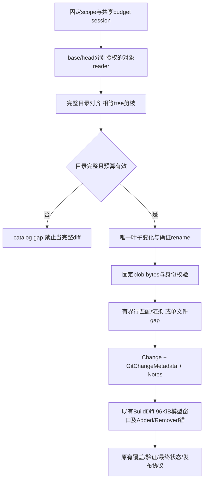

# API模式固定双树差异合同（F2设计）

## 可取消匹配器实验输入（2026-10-16）

本轮仍P6/F2研究，沿Confirmed需求和用户“没想清楚先不实现”。已有go-difflib行锚/无损渲染证据，但该候选不能匹配中途ctx取消；本轮允许仅修改独立scripts/probes/text-diff模块，不修改主依赖、生产reader/factory、仓库管理入口或运行合同。实现许可仅为合成算法探针，不能扩大为S4批准。

对照候选为标准最长公共子序列动态规划（[MIT课程原始材料](https://ocw.mit.edu/courses/6-006-introduction-to-algorithms-spring-2008/resources/lec20/)），不fork不可取消的第三方库。采用原始行token、精确相等、去除确定相同前后缀，再对中间区域计算完整LCS；重建最小增删脚本，不用超时后的“整片替换”fallback。算法实现为本项目研究代码，不能称为MIT/第三方维护的库。

拟验证：两侧仍各2000行/256KiB；每file DP最多4000000 cell，uint16完整表最多(2001×2001×2)=8008002 bytes。按行检查ctx和共享工作量，单次未检查循环<=2000个整数cell；backtrace和渲染另检查ctx。行内容精确intern后DP只比整数，避免内层反复比较长字符串。共享cell预算候选32000000（多个文件同实例、不自动重置）；不足/取消丢弃整个该文件hunk，错误不能降成空diff。该预算不是OS CPU硬限额，也不是已经持久化的run预算。

维护gate：现有main.go约271行，IO/oracle与renderer混合；新候选独立bounded_lcs.go，新增研究测试单独文件，不往原matcher插取消goroutine。仅抽出原renderer接受opcodes，原库对照继续运行，保留默认启发式反例。验收：原77组真实Git apply且拒绝offset/fuzz、重复单行精确锚、带长公共前缀的不同长行/反向/交错/完全替换、穷举短序列与独立oracle最小编辑距离、确定性中途取消、共享预算耗尽、输入/输出上限、内存和cell计数。超时不得遗留worker goroutine。性能仅观测，不宣称SLA；通过后再修订正式matcher选型及完整预算传播。

2026-10-16；codex/sidebar-workflow；输入为Confirmed requirements.md的语言无关PR审计、REQ-007/012/020、AC-007/018，以及repository-recovery-contract.md、repository-budget-contract.md和S4计划。当前不是已实现API-only原生审计，也不是完整S4开发许可。

## Workflow / Maintainability Gate

P6/F2；已核对githubObjectReader.rootTree/tree/blob、githubTreeWalk/listFiles、GitChangeMetadata/BuildDiff、GitLab metadata读取以及Git默认Changes路径。缺少API双树完整changes producer、固定PR observation、共享预算接线与完整factory。允许本轮写具体合同及研究现有候选源码；生产实现no。维护风险high：graph遍历、provider IO、text matching、hunk渲染和scope传播不可混为单文件；建议repository_tree_diff.go只做不可变tree节点比较，repository_text_diff.go做纯文本适配，GitHub/GitLab对象读取各自保持provider模块，factory负责编排。

本合同保持默认Git完整工具链，API-only不得偷偷调用Git。不能把增加read client方法或一个纯diff函数算作原生审计交付。无新UI、外部写入、主依赖或schema变更；未来唯一新增policy预算字段按独立预算合同处理。

## 问题与期望

GitHub compare返回的files最多300，不能翻页获得完整文件集；现有listFiles只返回regular files且有2000文件限制，不能直接作为完整metadata树。期望在固定merge-base/head上，独立建立完整变化目录，超过覆盖/对象/预算限额明确incomplete，不把未观察路径视为不存在。PR base分支移动不影响已冻结run。

compare只可提供经固定观察验证的merge-base等元信息；其files/patch/rename不作为完整changes权威输入。主仓与fork source分别用授权reference/client读取，不能用一个token或target数字ID假读source。

## 提案内部对象（全部新增、尚未实现）

| 对象/字段 | 类型/必须 | 所有者/校验 | 兼容 |
| --- | --- | --- | --- |
| PinnedTreeSide.reference | RepositoryReference/必须 | scope冻结身份；使用前后原有fence，不能从path推授权 | 不替代scope或授予权限 |
| PinnedTreeSide.commit | string/必须 | base=observation.merge_base_sha，head=observation.head_sha，必须匹配Snapshot | full SHA，不用branch |
| TreeNode.path | string/必须 | provider返回规范相对路径，UTF8、无控制字符/空段/..，<=4096 bytes、depth<=64 | 无法表达路径记缺口，不修正/归一化成另一文件 |
| TreeNode.entry | GitEntry/必须 | mode/type/OID按已有validGitEntry；tree单独040000；SHA按provider格式 | 复用既有metadata |
| TreeNode.size/size_known | int64/bool | blob已知非负，缺失不能假0；同OID矛盾size拒绝 | GitLab树不提供size时由有界blob读取证明 |
| TreeDelta.changes | []Change/必须非null | 有界、唯一稳定排序；路径/flags/metadata相互一致 | 复用Repository.Changes输出 |
| TreeDelta.catalog_complete | bool/必须 | 全部变化目录已完整建立才true | false绝不能输出“无变更”安全结论 |
| TreeDelta.gaps | []typedGap/必须非null | 有限code、side/path/阶段/范围；不含原始响应/密钥 | 后续映射现有Notes/Coverage |
| TreeDelta.text_complete | bool/必须 | 目录完整不等于所有文本已检查 | 二进制/大文件/预算等仍可false |

这些不是新的公共HTTP字段；执行结果通过既有Change/Notes和覆盖投影导出。若需要public typedGap，必须另补producer→DTO→TS→导出/通知/检查传播，不能只发后端枚举。

## 双树目录算法

1. 按scope验证target/source/context、credential和预算op，源角色授权后才读取源commit/tree/blob。base与head分别取固定commit的tree，验证对象身份与完整节点响应；Github沿已有rootTree/tree方法，不能让递归tree truncated=true进入cache。
2. 使用队列对齐同一路径的base/head目录。已验证的两侧tree OID相等时，该子树可整体跳过；权限/fence仍执行。GitHub可按tree OID读取；GitLab若只能按commit+path列目录，其cache key必须包含固定commit+path，不把未知root OID伪造为已知。未知或不可信相等不能用于剪枝。
3. 每个目录必须完成所有页，才可判断某entry缺失。GitLab按per_page100顺序验证NextPage/Link；缺失/矛盾分页元数据或满页但无法证明末页是gap。GitHub单目录API明确truncated=false；不得用2000条截取后当完整目录。
4. 同名entry双侧比较：同mode/type/OID且大小不矛盾为不变；目录对目录递归；文件对目录先完整展开目录那侧，再表示旧文件删除及其子项新增，反向同理；不同类型普通entry形成type_change。
5. 单侧目录也需完整展开后输出叶子add/delete，包含regular、executable、symlink和gitlink元数据，不只列regular文件。gitlink仅描述记录的commit，不访问其外部仓库；symlink仅是blob对象，不解引用路径。
6. 每侧每条ancestor链检查cycle；重复tree可出现在多个prefix，不能因全局visited跳过另一路径。缓存命中不免expanded-entry/path-byte计量，防止小DAG指数展开。
7. 目录预算为两侧合计：expanded entries<=20000、每directory<=2000、输出叶子changes<=2000、累计规范path bytes<=8MiB、depth<=64；全程还受共享请求/API byte/grant预算及ctx约束。达到限额不返回半个目录为完整。
8. 目录异常时catalog_complete=false，保留已验证条目只供诊断；正常Repository.Changes包装不得将其送成完整PR差异开始模型审计。由Runner以coverage不足终结/明确incomplete，不把剩余路径推断为add/delete。文本阶段的单文件缺口可保留完整目录和其他有效证据。

对301个实际变更的受控fixture必须输出301项，不读取compare.files作为权威；2001项应显式不足而不是静默截断。相同tree剪枝需要固定对象身份依据，不能以“文件名没出现在compare”剪枝。

## 元数据与rename/copy规则

每个Change复用GitChangeMetadata，add/delete的OldPath/NewPath均填该路径以满足现有valid协议；缺侧entry为nil，同路径修改填实际两侧entry。可执行位变化但OID不变为metadata-only。目录不作为可锚定文件；gitlink只允许metadata锚，不能发明内部文件行号。

跨路径rename只在一个删除与一个新增具有完全相同mode/type/OID，且该组两侧各唯一时认定。多对多或带内容变化不猜测；保留完整delete/add，不能凭同名/标题/部分API列表合并。copy表示新增，不做推断。此规则可能与Git相似度rename结果不同，但对象/路径覆盖必须完整；不能因未认定rename丢掉文件或复核记录。若需要展示“未做相似度重命名推断”，必须用中性说明而非把完整覆盖标为失败。

## 文本取得与证据

- 只在目录已确定真实变更后读两侧必要blob；所有读继续同ledger/op，不为第二侧新建额度。
- regular/executable、symlink目标均可通过固定blob OID取原始bytes；symlink不跟随，不访问任意URL。本提案若扩展API ReadFile对symlink返回目标，必须明确标为link对象内容并补契约测试；未完成该一致性前symlink仅输出metadata和文本缺口，不能说其目标已审计。
- GitHub沿blob API base64/size/sha1校验；GitLab使用固定blob raw对象endpoint，验证响应实际size与按当前object format计算的blob OID。未知format或provider协议不支持时拒绝，不降到默认branch/Contents URL。正式GitLab raw协议及SHA256受控兼容测试是实施前依赖，尚未执行。
- 每blob<=256KiB。NUL、无效UTF8、大文件、缺失对象/内容或对方权限不可读均给对应路径gap；不空字符串代替。空blob是合法0字节，必须与读取失败不同。
- blob bytes在scope/credential绑定cache内不可变。重复相同OID可复用内容但cache命中仍做fence。文本hunk缓存按已授权两侧身份及OID对，最多512项/8MiB，防止同内容重复路径反复消耗匹配CPU；path/metadata不从别的文件复用。

## 行匹配与hunk渲染候选

拟固定github.com/pmezard/go-difflib v1.0.0，只使用NewMatcherWithJunk(base, head, false, nil)/GetGroupedOpCodes(3)的行匹配；默认NewMatcher的autojunk已被下文实测否决，不可用于PR行锚，不直接采用GetUnifiedDiffString输出。已读[该tag源码](https://github.com/pmezard/go-difflib/blob/v1.0.0/difflib/difflib.go)：writer原样拼接输入行，不能直接保证无末尾换行文件的Git sentinel语义；其buffer Flush错误也不作为调用返回。主go.mod当前未新增此依赖，go.sum已有校验不代表已经正式依赖或验收。

纯适配器需：

1. 按LF拆成保留原始换行的token；CRLF不归一化；空文件为0 token；最后无LF的token保持无LF。两侧token<=2000、bytes<=256KiB，否则仅标该文件text budget gap，不把整片中间区域全标新增。
2. 用matcher的grouped opcodes建立区间；对每opcode验证单调、无越界、两侧覆盖一致。未变区间确实bytes相等，replace/delete/insert按真实输入token渲染。
3. 输出从@@开始，与既有Git Changes一致；hunk起点/长度从token区间算，不从服务器patch抄。空range起点按unified diff规则为相邻位置，可为0；added/removed锚仍是原侧真实1-based行。
4. 每token写prefix后原始bytes；没有LF时补输出LF和`\ No newline at end of file`标记，不能把下一行header贴到同一行。不在源文本中补LF后再比较，必须保留仅末尾换行变化。
5. 显式有界builder检查每次写入，hunk输出<=512KiB/文件且整次<=8MiB；不靠defer Flush吞错。单文件超过则丢弃该文件不完整hunk并标gap，不返回截断hunk。
6. 匹配前后检查ctx；该库不支持中途ctx取消，2×2000行/2×256KiB为输入上限，不能宣称它提供硬CPU时间限制。正式采用前以重复长行/高重复/全部替换反例测运行开销；若不能满足运行预算则替换为可中断matcher，不能用goroutine超时遗留计算继续消耗CPU。

这是明确候选而非生产选型。API diff可与Git选择不同的有效匹配，但所有删除/新增锚必须来自能无损把base变为head的edit script；尤其不能把“首尾间全替换”当精准差异的捷径。匹配性能/边界与依赖安全扫描未验证，不能从成熟库标签推导已就绪。

## 数据流

BuildDiff的96KiB是模型初始窗口，不能替代完整变化目录；窗口遗漏仍沿现有覆盖说明。formatter中性信息、真实text gap和目录失败应区分：不能将所有Notes无差别变成阻断，也不能丢掉真实coverage gap。

## 实施交接与反例验收（尚未执行）

- 真实API transport fixture分别实现GitHub tree/blob与GitLab tree分页/raw blob，内容从同一临时真实Git仓库生成；禁Git PATH时API-only仍完成取数，运行命令计数为0。Git仅在测试侧生成oracle，不能由被测adapter偷偷使用。
- 301变化、2001变化上限、>2000个未变文件中的少量变更、双树相同OID剪枝、共享子树不同prefix/DAG、cycle、错误size/SHA/type、无效/非UTF8路径、分页重复/丢页/满页无末页证据、截断tree、source撤权中断均有判定结果。
- mode-only、regular↔symlink、文件↔目录、gitlink、空文件、全删除、全新增、单行无LF、只改末尾LF、CRLF、Unicode、二进制、大blob、重复长行、rename唯一/歧义/内容变动验证路径集合与metadata，不要求API相似度rename与Git猜测完全相同。
- text edit script应用base必须逐字节得到head；对简单非歧义case与实际git diff --no-ext-diff --no-textconv的Added/Removed行锚核对，BuildDiff不得产生不存在或未变化的锚；对于多种有效匹配的case验证重建与固定侧证据，不强行继承另一个算法的行号。
- budget/ctx/错误/缓存/revoke/fork分别断言实际请求次数与字节：不授权零内容读；双树同ledger；不完整目录不得返回空成功。无真实模型/托管服务请求。
- 集成条件：最终factory正式v51 producer、所有consumer和预算/网络/资源合同通过；先保持原guard，不因为纯算法测试通过开放绑定。

## 仍需关闭的实施决策

生产matcher adapter与完整链的CPU/ctx资源约束（局部语义/依赖实验见下）；GitLab固定raw对象及SHA256受控协议证据（仅资料核对已完成）；symlink读取工具的一致语义；typed gaps到现有覆盖与状态投影的准确映射。不得默默猜测这些规则进入生产。完整资源隔离设计独立推进；本文件不宣称原生GitHub/API模式、跨仓完整流水线或UAR-001已完成。

本轮只完成设计；writer提交601ff98已推送codex/sidebar-workflow。已对现有调用/对象读取与固定tag候选源码作静态核对，git diff --check通过；没有运行尚未实现的双树/文本测试或安装新主依赖。未来必须按上文受控反例取得证据，不能将本轮写作计为功能完成。

## 行匹配候选实测输入（2026-10-16）

沿用F2/P6 gate，仅允许scripts/probes/text-diff独立module对固定go-difflib v1.0.0做合成验证；不修改主依赖或生产reader。夹具需覆盖空/新增删除/CRLF/Unicode/无末尾LF及仅LF变化，生成patch由实际Git apply --check/apply还原到目标bytes；对简单确定case检查Added/Removed行号。重复1999行中间一个修改必须额外比较默认autojunk与关闭heuristic，不能仅证明patch能apply就声称PR锚精确。按2000行/256KiB边界记录开销，取消不启动遗留计算goroutine。库不具ctx中断的局限继续记录，结果不自动批准生产采用或完整API模式。所有文件/命令在临时合成目录，禁止读取用户repo或调用真实平台/模型。

## 候选实测结果：默认autojunk不能作为PR行锚

独立scripts/probes/text-diff模块固定go-difflib v1.0.0，主go.mod/go.sum无变化；实际Go1.27.2本机Git2.50.1，合成目录和文本，无真实仓库/平台/模型访问。

- 默认autojunk=true：1999行“same”重复内容中只改第1000行，输出1000行added和1000行removed。patch能由Git apply正确还原，但会把大量本来相同的尾部行列为修改，故仅验证patch可用不足以证明PR审计精度。提案从NewMatcher改为显式false的NewMatcherWithJunk，不能将此默认模式直接生产接入。
- autojunk=false：相同case只标added=[1000]/removed=[1000]；简单替换只标两侧第2行；两者都由真实Git apply还原到精确head bytes。
- 自定义有界渲染13个明确case通过：空/不变、增删、CRLF/只改行尾、Unicode、无末尾LF和仅末尾LF变化等；另64个固定seed的重复/空白/类似hunk header内容、混合行尾随机case全部由真实Git apply还原。未用生产BuildDiff或API reader，不能据此宣称pipeline验收完成。
- 原库直接writer在无末尾LF的old→new case不能通过Git apply还原；不能直接用该writer产生审计hunk。probe补齐无末尾LF标记，限额错误不输出部分成功。
- 最终-race运行exit0，无race；重复1999行精确模式342653微秒，2000行120-byte稠密替换2390微秒。此前独立非race观测分别169033/704微秒，只是该输入/本机的观测，不是最坏时延或SLA。取消预检查和输入行/byte/NUL/UTF8拒绝通过；库本身不支持匹配中途ctx终止，仍不能用goroutine超时掩盖残留计算。
- 独立模块govulncheck@v1.8.0 -show verbose ./... exit0，扫描此module、固定library和Go1.27.2；reachable/package/module均未发现漏洞。扫描时点结果不是未来无漏洞保证，主module未加依赖。

选择边界收窄为“显式关闭autojunk的matcher+保留LF的自定义有界renderer”；需后续生产adapter/完整双树/覆盖映射测试及资源设计后才能实施。此研究不关闭S4/S5/S6或UAR-001。raw writer/默认启发式失败属于未接入候选的反例，不是当前生产已发生的误报。

### GitLab raw对象协议的资料核对

[官方Repositories API](https://docs.gitlab.com/api/repositories/#retrieve-raw-blob-content)明确提供GET /projects/:id/repository/blobs/:sha/raw按blob SHA取得原始bytes；同页说明普通base64 blob响应可能先把非UTF8内容转码，size仍是原始size。因此原始对象hash验证与文本分类必须基于raw endpoint，不从转码后的JSON内容假称原始证据。接口文档仅将sha定义为字符串，没有据此证明所有GitLab版本都支持64位SHA；SHA256、权限/限额、分页及异常响应仍需受控协议测试，不把本次资料核对计为实际provider验收。批量blob仍处beta，当前方案不为省请求引入该接口。

最终渲染校验还拒绝Git apply --verbose报告的offset/fuzz；已用同一正确patch故意把hunk起点+1做正/负对照：允许offset时Git可还原，严格模式拒绝。因此77组还原不会借Git偏移校正掩盖错误坐标。最终-race命令exit0，精确重复行338593微秒、2000行稠密替换1894微秒；均为单次本机观测。最终source的govulncheck仍exit0/无漏洞，未使用抑制。一次gofmt调用误带根目录相对路径，未格式化该文件；正确module目录下gofmt完成，实际Go执行与最终检查以成功命令为准。

### 提交与CI追踪

6e93e420c7bd413e1523e61ff98cc4946de2274b已推送codex/sidebar-workflow，正常root module未引入新依赖/生产调用。[精确代码CI38848503334](https://github.com/Ed1s0nZ/AIMergeBot/actions/runs/38848503334)已查询in_progress、conclusion为空；普通CI不运行独立module，实验依据仍为上述显式Go run/race/govulncheck命令。上一生产ea25ab59f56507a4fc629713f38a55774f8f9299的CI38847438292已completed/success后才推本研究代码，没有取消旧验证。本条只更新文档；无main合并/部署。完整目标与native流水线继续进行中。
