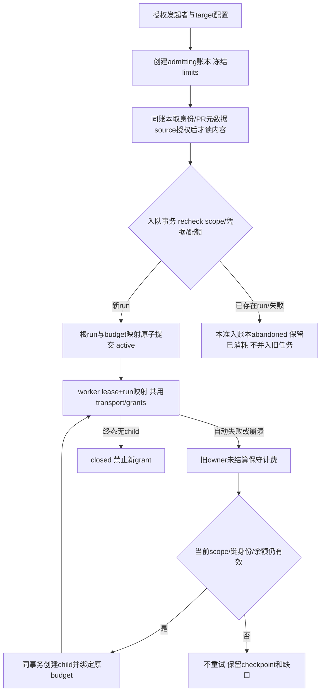

# 原生仓库取数预算合同（F2设计稿）

2026-10-16；codex/sidebar-workflow。输入：Confirmed requirements.md 的REQ-007/012/020/023和AC-007/018/021；repository-recovery-contract.md、repository-recovery-implementation-plan.md S4、repository-native-transport-research.md。目标是让原生PR、多仓上下文和重试使用真实统一预算，不改变语言无关审计，不减少原REQ-001–023/AC-001–021。本文是具体技术提案，未获F3实施许可；生产factory仍关闭。

## Workflow / Maintainability / Lifecycle Gate

- 当前P6/F2，任务为跨Store/HTTP/Git/Runner的预算设计；上游身份与凭据合同、当前worker lease/自动重试代码、两类取数探针及额外URI反例均已取得。
- 尚缺：完整native factory、API双树diff与资源隔离设计/验收、所有producer/consumer接线。不能靠单独ledger模块宣称交付。
- 本轮允许文档设计、轻量一致性检查；不允许生产实现或新产品入口。先完成本合同和评审，再把预算/网络/资源合同合并到S4完整实施计划；不在本轮写孤立未使用的生产模块。
- 维护风险high：Store/Runner/重试/网络/模型工具跨边界。计划独立repository_budget_{policy,store,reservation,transport}.go，Runner及原client仅委托，不将SQL、流读取和scope验证塞在同一函数。无大范围重构许可。
- 验收为字段、数值、所有权、并发计量和重启语义可判定；不以本设计代替实际测试。分支提交/推送仅文档，无main合并或发布。

## 当前事实与边界

GitHub client现有每client128次请求、32MiB，单响应8MiB；本地Git默认max_pack_mib256、history_depth200、max_tool_calls80。多个仓库分别新建client/工作区会乘出额度。现有failAndRetry/recoverAttempt创建child run，最多2次自动重试；只向ctx传指针不能覆盖重启或新child。

本合同的repository预算覆盖准入元数据取数、固定快照、Git/API对象读取、context、CODEOWNERS和审计工具读取，以及同固定身份的自动重试链。模型token/通知/检查与工单发送继续使用各自协议，不与对象读取混成一项。显式新HEAD复审或人工重新运行是新根操作，需重新执行配额和授权，不是假装旧链续跑。

## Proposed limits：准确值及来源

新原生v51 policy冻结以下数字；均为int64字节/计数，不用浮点。不新增第一版设置页控制项：采用版本化固定常量，已有Git字段继续冻结。后续调参必须改变新policy版本，不热改进行中账本。

| 字段 | 提案值 | 理由与验证 |
| --- | --- | --- |
| version | 1 | 预算合同版本，与repository_scope.version独立 |
| requests | 512 | 所有仓库、API/Git及自动重试共享，保留最多4个现有API client量级的整体上限；不是每仓512 |
| api_response_bytes | 33554432 | 延续现有32MiB但改成整体共享 |
| git_response_bytes | policy.git.max_pack_mib ×1048576 | 延续已配置16–4096MiB，默认256MiB，改为全部Git route/重试合计 |
| upload_bytes | 8388608 | 整体8MiB；仅upload-pack请求体，单体最多1MiB；API GET不消耗此项 |
| download_bytes | api_response_bytes + git_response_bytes | 总下载实体上限；同时扣总量与分类量，默认288MiB，防止换分类重复获额 |
| grant_bytes | 1048576 | 每次持久预留最多1MiB；stream内部64KiB读取，减少每个Read一次SQLite写入 |
| per_api_response_bytes | 8388608 | 保持当前8MiB；对象/目录原有更小上限仍适用 |
| per_git_response_bytes | git_response_bytes | 同一pack响应不能超过剩余整体Git额度，不伪称这是展开体积 |
| parallel_requests | 2 | 同账本同时最多2个已派发请求；主/source/context公平等待，等待可取消且不消耗请求次数 |
| admission_timeout_seconds | min(policy.timeout_seconds,60) | 准入阶段独立60s上限；worker继续沿已冻结timeout_seconds，不能把准入无限放在运行timeout外 |
| text_match_cells | 32000000 | API文本DP比较的整体预扣额度，根run及自动retry共享；不是每文件一份或CPU秒数 |
| per_text_match_cells | 4000000 | 两侧各2000行的最大DP中间区域，单次完整预留，不按每个cell写SQL |

limits全部服务端生成，v51必须实际包含并匹配本版本公式；缺失、null、未知字段/版本、重复key、负数、算术溢出或不匹配冻结Git设置一律拒绝。不把错误值default修好后执行。GitLab/GitHub及API-only使用同合同；API-only不得因Git额度存在而启动Git。历史v50/nil没有预算证据，不能回填这组数字并宣称历史已计量。

## 数据结构与持久化

建议schema3承载账本，停止旧进程并原子迁移。新增对象字段下表为全部核心字段；列为NOT NULL时无业务默认，只有计数初始化为0，禁止INSERT OR IGNORE丢失协议约束。

### AuditPolicy.RepositoryBudget（新增可选JSON字段）

类型*RepositoryBudgetLimits，JSON repository_budget；上表各field为required int64。只有新v51 producer必填；旧policy缺字段兼容读取，不改其digest或scope，不给它隐含原生权限。预算ID不进入policy，因为它属于一次执行而不是可复用策略。深拷贝、JSON严格解码、digest、retry/followup/poll/webhook/store装配和测试必须完整传播，不能只改struct。

### platform_repository_budgets（新增）

| 字段 | 类型/必须 | 创建/校验/所有者 | 生命周期 |
| --- | --- | --- | --- |
| id | TEXT PK，32字节随机hex，必须 | 服务端生成；不作为授权凭证、不放URL | 一次准入及其根run的账本 |
| root_run_id | INTEGER UNIQUE FK run，可NULL | 准入时NULL；根run INSERT同事务绑定，之后不可改 | 无run的准入也有消耗记录 |
| project_id, actor_id | INTEGER，必须正值 | 启动准入时授权；actor不可由HTTP body伪造 | 保留原发起者，不随retry改派 |
| limits_json, limits_digest | TEXT，必须 | 严格有限JSON与SHA256；入队后匹配冻结policy | 不热更新、不从当前Settings重算 |
| state | TEXT，必须 | admitting / active / closed / abandoned | 仅规定迁移可变更 |
| session_epoch | INTEGER，必须 | 初始0；OpenSession条件递增、溢出拒绝 | 旧session无法退款或继续取额 |
| admission_owner, admission_lease_until | TEXT，必须 | 随机owner/合法UTC时间，准入独占lease30s、每5s续期，且不超过准入deadline | 绑定根run后清空，不作为worker owner |
| api_charged, git_charged, upload_charged, download_charged, requests_charged, match_cells_charged | INTEGER，必须 | 初始0，CHECK非负且不超过对应冻结limit；SQL条件扣减/CAS | 已消费或仍不确定的预留均保留计费；cells不是bytes |
| created_at, updated_at | TEXT，必须 | 服务端UTC | 不用客户端时钟 |

### platform_run_repository_budgets（新增）

run_id INTEGER PK/FK、budget_id TEXT FK，二者必须；根run绑定与INSERT在同事务，自动retry child绑定同budget_id且先验证现有retryBudgetAncestors固定身份/digest/序号。不得给同run换账本；一个根budget只能对应一条无分叉retry链。显式followup/新人工run创建新budget，不能挪用旧grant。

### platform_repository_budget_reservations（新增）

| 字段 | 类型/必须 | 校验与所有权 |
| --- | --- | --- |
| id | TEXT PK随机hex，必须 | 不可复用的操作id；重复创建只返回完全相同receipt，否则冲突 |
| budget_id | TEXT FK，必须 | 绑定账本，不能跨根run转移 |
| run_id | INTEGER FK，可NULL | NULL仅admitting；active必须等于调用worker run |
| owner_kind, owner, lease_epoch | TEXT/TEXT/INTEGER，必须 | admission或worker；worker复用当前worker_owner和run lease；epoch用于本次session，不从HTTP接受 |
| kind | TEXT，必须 | request / api_read / git_read / upload / text_match |
| reserved, settled_used | INTEGER/可NULL | request固定1；bytes范围1..grant_bytes；text_match范围1..per_text_match_cells；used范围0..reserved，NULL代表未结算。text_match按下文固定全额charged，不套byte退款 |
| state | TEXT，必须 | open / settled / charged_unknown；只允许open到后两者 |
| created_at, settled_at | TEXT/TEXT可NULL | 服务端UTC；审计顺序 |

receipt不保存token、URL、响应或源码。终态receipt保留以拒绝矛盾重放，不能删除后再次退款。新增固定max_reservations=8192（required int64，v1只允许该值，纳入limits_json/digest和policy严格解码）；每次预留前同事务检查该预算累计行数，不能用1字节反复预留/退款制造无限行。正常byte grant必须等于min(1MiB、分类/整体可用余额、单响应剩余含探测字节)，不能由调用者任意缩小；只在耗尽或EOF时结算后再取下一grant。加入text_match receipt后，高端字节额度与大量小文件、多次retry组合可能先用尽receipt行数；各limit是独立上限，不保证能同时用满，必须明确输出accounting/coverage缺口，不能重置账本规避。是否需要调整8192须以完整S4压力数据决定，当前不宣称所有最大组合均能容纳。保留策略随run历史；abandoned且root_run_id为NULL的账本在所有lease/请求结束至少7天后可整组清理，不能只删receipt后复用counter。未结算receipt和counter必须事务一致。

## 准入→运行→重试生命周期

准入不持有数据库事务跨网络。admission lease过期后旧owner不能续期、attach或结算退款；将残留open reservation标charged_unknown而不增加counter（二者早已预扣，不能双计）。abandoned账本不能被新准入复用。重复请求可以查询原已存在run；新消耗不能冒充该run的既有完整预算。

worker session仅在Claim事务后根据run映射打开；epoch在每次session创建时递增，不能仅靠进程owner（同进程多个run可不同session）。需要在budget表补充session_epoch INTEGER初始0，OpenSession事务先验证run lease/链尾，再递增并返回token；所有worker grants匹配该epoch，旧owner不能退款或复活预算。该字段为新增required server counter，不用机器时间代替代次。retry worker不是新limits，也不是重新清零counter。

Recover/FailAndRetry与child映射在现有事务内完成，不能先写child后另建budget。计量异常、耗尽或身份改变不是临时网络错误，retryFailure不得自动重试。旧attempt的已派发请求可能在途，不能声称已撤回；现有ctx/fence停止其下一次读和结果交付。手工新run仍受当前用户权限、运行配额和去重限制。

## 预留/读取/结算协议

1. 在任何HTTP dispatch前先进行已有scope/ACL/凭据/lease检查，再事务验证账本状态/owner/epoch并扣request=1；提交成功才可dispatch。请求receipt不退款，构造失败也保守计费，不能靠错误请求获得免费重试。
request reservation在收到响应并关闭body后以used=1标settled，关闭只释放并发slot、不退款请求计数。只有当前有效session的open request计入parallel_requests；更换session先把旧open标charged_unknown，不能因为旧owner永不结算而永久占据新session的slot；旧owner后续任何grant/结算都被epoch和run lease拒绝。请求并发和预算累计次数是两个不同计数。

2. 请求体只接受有限内存体或受控reader。upload-pack体先有界构造到最多1MiB，派发前预留其完整长度；实际写入不超过预留。API必须GET无体；不转发caller cookies/headers或跟随redirect。禁止自动压缩，响应Content-Encoding非空且非identity直接拒绝，不能在账本外解压。
3. 响应stream申请最多1MiB grant，同时扣download及api/git分类。SQL检查used+requested<=limit，溢出前先比较limit-used。并发grants的总和也已计入counter，所以任一时刻承诺可读取的bytes不会超过整体额度。
4. 每次Read buffer不超过本grant未消费部分、单响应剩余额度与64KiB；Read返回n即增加内存consumed，错误/撤权后丢弃的n也计费。probe超限的额外1字节同样要先预留，不能免费peek。每次消费前后沿现有fence检查，不将DB授权观察解释为已派发网络可瞬间撤回。
5. grant读完或EOF时以reservation id/owner/epoch/state CAS结算，used必须0..reserved；只退款未消费部分。settled重复相同used幂等；不同used或畸形字段拒绝，零退款。数据库失败不继续读，新grant停止；已预扣仍在，不能回滚真实网络消耗。
6. ctx取消时停止Read并Close body；能以有效session安全结算则正常退款，否则保留open→charged_unknown上界。worker crash/lease失效/session更换不再退款旧grant。已消耗事实不可从空trace或请求错误推断为0。
7. 没余额时不再调用底层Read；若尚未观察EOF则返回预算覆盖不足，不能返回假EOF或部分成功。恰好读到单响应limit时仍需要受预算约束的EOF探测；预留额度不足则保守incomplete，不偷读limit+1。

预算记录是保守charged上界，特别是crash未结算grant；对外不得写成精确网络流量或费用。可展示charged、limit和unknown标记；没有单独精确used证据时不输出精确值。网络线上TLS/TCP与内核buffer不在实体byte语义内。

## API行匹配的持久工作量（F2补充，d8948ce研究输入）

采用有界LCS候选时，cells是完整DP表中执行比较的行列乘积，不是网络bytes、总指令数、CPU时间或费用。每侧2000行/256KiB输入仍先验证；精确intern和确定相同前后缀裁剪有独立有限输入与ctx检查。中间n×m由服务端计算（0..4000000，checked整数），不能由HTTP/model传入声称“只花1 cell”。

生产adapter拟在一次不可变blob对匹配前，使用相同budget/owner/epoch事务预扣整个n×m，写kind=text_match receipt；再在本地逐行检查ctx运行。与byte grant不同，一次匹配最多1条receipt，不对每row/cell写SQLite。reserved全额保守charged，成功、取消、输出超限或崩溃后均不退款；settled_used固定reserved，表示额度口径而非声称实际执行了全部cell。未结算在换owner后仍charged_unknown，不转成新owner可复用的计算许可。

n×m=0不创建零值receipt、不扣DP额度（纯增删、完全相同等仍受输入/输出和ctx边界）。内存中cache命中不重新执行DP，仍复查原scope/ACL/credential；cache未命中、重启或新retry即使内容相同，真实重新执行就重新预扣，不能复用旧receipt当新计算凭证。一个receipt最多授权一次本地执行，响应未知时重放只允许取既有结果；没有缓存结果不能再次执行却免扣额。

同预算的匹配串行，避免多个8MiB DP表和共享单owner matchWork同时运行；排队可取消，dispatch前复查session。正式实现需要事务reserve与本地single-owner allowance连接，研究matchWork只证明局部不超额，不能直接当持久账本。并发争剩余额度只允许一方成功；自动child/restart沿同根counter；缺receipt/错误kind/非法范围/旧epoch均零DP。

工作额度耗尽使对应文件text incomplete，不用全片replace或空diff冒充精确比较；缺完整变化目录仍按catalog规则失败。新有限code repository_text_work_exhausted需沿coverage/DTO/TS/导出/检查传播。极小文件的前后缀/编码/渲染工作不是DP cell，仍受整个目录最多2000changes、256KiB/side、hunk/caches和run deadline约束，不能将cells宣传为整个审计CPU硬quota。正式schema3/v51严格limits解码、digest/clone、worker/retry与SQLite反例一并进入S4计划，本轮没有实现这些持久对象。

## 所有消费者与数据传播

| 入口/消费者 | 必须行为 |
| --- | --- |
| HTTP手工提交/poll/webhook/Slack复审/followup | BeginAdmission获得同一op；身份/元数据读取使用它；Store入队原子attach，未授权不创建op或远端请求 |
| snapshot/source/context读取 | 固定reference，source授权前不读内容；不得每仓各造ledger |
| Runner/分组/验证/图表工具 | 共用session ctx；模型调用本身沿独立token预算，其repo工具仍走同ledger |
| Git worker | 强制网络gate；HTTP/HTTPS额外URI反例也受拦截；stderr/pack/file不得绕过计量通道 |
| API-only | 完整双树/对象读取共用API额度；>300 compare不冒充完整；不启用Git |
| CODEOWNERS建议 | 在任务执行内用当前session；任务完成后的用户显式查询为独立有界读取操作，不能向closed run偷偷续额或改写原审计消耗；需单独投影“查询操作” |
| 自动重试/Recover | 原预算、原limits；同事务创建映射，重启不重置，未知预留保守计费 |
| comment/check/通知 | 已有外部写协议不计repo预算；若必须额外读最新仓库状态，应明确独立publication读取操作及额度，不能以新session扩充旧审计范围 |

上表不是当前已实现事实。任务结束后的CODEOWNERS/publication是不同生命周期，必须在完整S4 consumer计划落实其独立op与审计说明，不能把每次用户查询都混进closed run后强行开放旧budget。

## 故障、状态和对外反馈

内部typed codes拟定repository_budget_exhausted、repository_budget_accounting_unavailable、repository_budget_identity_changed、repository_budget_lease_lost；错误只含有限code，不含URL/token/SQL输入。是否为coverage incomplete或当前已有failed由Runner原最终化协议决定：已取到部分合法结果保留证据并记录缺口，不能标为完整成功；未取到固定对象时不得把空数组当“未发现问题”。codes从生产者→错误映射→结果/重试→DTO/TS→测试完整传播后才开放。

## Schema、旧数据与回滚

- 设计采用schema3（新增账本及session_epoch），schema1/2停机后同事务迁移，旧程序必须拒绝新版本；不以只新增表但保持version2允许旧程序静默忽略预算。
- 旧v50/nil运行继续保留历史原样，消费按已有legacy身份guard，不伪造scope/limits/消耗。新native执行只接受v51和完整ledger。旧任务如需要native身份恢复，仍走S5明确恢复/新run规则，而非给旧任务制造预算授权。
- 不把未知旧消耗当0，不从空trace回填精确网络统计；旧policy导出标明未计量。新v51每入口都必须有预算映射，缺行/错误limits/身份冲突全部拒绝，不降级旧路径。
- 回滚需恢复一致DB备份与对应程序，不能降version删除账本来宣称旧run没消耗。部署须先停止旧worker与HTTP准入；本轮没有执行迁移/部署。

## 验收与实施依赖（尚未执行）

预算本身必须真实SQLite/Close-Open/双连接并发验证：只剩一次请求时16个并发reserve仅1个成功；8192行满后新预留拒绝、旧行矛盾退款不被当作可复用位置；总/分类bytes一起扣；跨4个context不增额；退款相同重放一次、矛盾重放零退款；lost commit/settlement错误/owner切换保守计费；过期admission不能attach；重启/recover/child不重置；强制child插入失败时映射/事件回滚；旧schema拒绝；v51缺字段/unknown/重复key/映射缺失零网络；v50历史不被重写。

HTTP/Git整链必须用真实CGI/受控API验证：上传/下载并行预留不超承诺量，grant边界/limit+1/EOF不假成功，错误/撤权/超时后已有bytes不免费；API-only>300文件、fork及上下文共享；正常固定SHA/SHA256、本地Git工具与额外HTTP/CONNECT拒绝；运行后CODEOWNERS/发布明确独立op而不污染旧统计。还需有观测数据评估1MiB grant和SQLite串行写的开销，再决定是否调整常量；不能先宣称性能最优。

实施顺序：完整S4方案合并预算/受控网络/资源/API双树与producer/consumer设计并通过评审→schema3/严格limits→原子admission/worker/retry归属→受控transport/Git/API消费者→端到端覆盖/错误传播。禁止只实现schema和ledger就开放仓库绑定，或把本合同当作S4/S5/S6已经完成。

## 必须在完整S4设计关闭的事项

1. Git进程内存/CPU/展开磁盘与整体workspace资源模型，以及支持环境和观测/硬限制区分。当前取消修复和网络bytes不证明资源沙箱。
2. 最终网络gate的地址、认证、proxy bypass/URI scheme矩阵、DNS/CIDR、双origin映射；loopback研究proxy不是生产实现。
3. API双树diff完整算法、mode/rename/gitlink/merge-base/fork覆盖，以及单对象/tree/全图上限传播。
4. 所有后台准入、重试、结束后读取与发布消费者如何获得正确op；session_epoch的schema/映射与原worker lease交互需要在实施计划逐点列出调用方。

这些尚未完成，故本文件不批准生产开发；完整用户目标保持进行中。本轮仅写设计，不调用模型/真实平台/邮件或机器人，不合并main。

## 本轮设计检查记录

已对照当前audit_retry.go（最多2个自动child）、retry_model_budget.go（固定祖先身份对账）、worker_lease.go（30s实例lease与5s心跳）、repository_scope_json.go（最多4个context）以及现有Git/API限额核对。提出的持久预算没有被假装成现有功能；上述自动重试传承与旧v50边界均有明确记录。轻量git diff --check通过；本轮没有实现或运行预算测试，前文验收仍是待执行清单。

writer提交ba1dc89已推送；后续本补充仅修正设计中的receipt行数上限、session_epoch字段位置与并发slot回收规则。上一研究代码b2cd0bd的CI38844119652查询仍in_progress，未借旧成功续期；本文文档变更不改变其受测源码。
