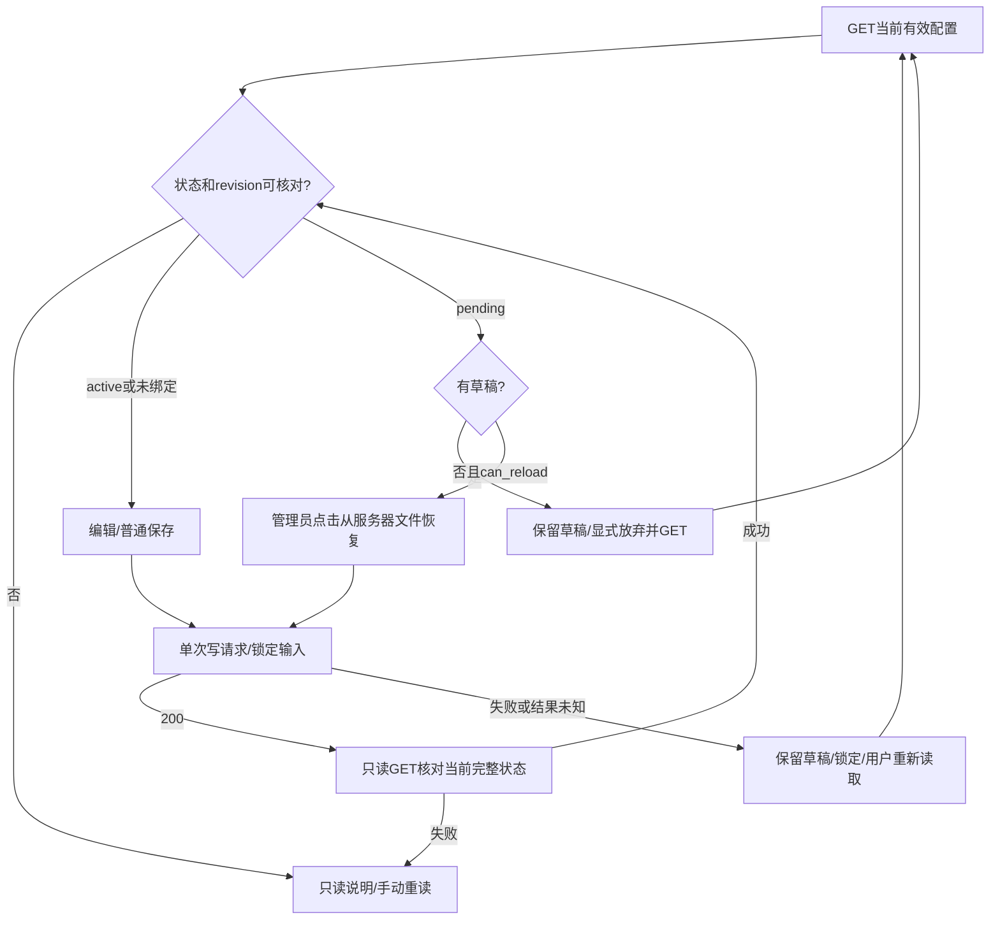

# S3d2：现有设置页的显式恢复流程

2026-10-16，codex/sidebar-workflow，F2/F3。输入为Confirmed requirements、S3d reload合同及e7e0a77后端。范围不缩减REQ/AC；不实现未确定的自动修复/门禁放行/工单重发。

## Workflow Gate / 背景

用户问题：已有恢复后端，但管理员没有在设置页核对/恢复的完整流程。当前P2/P3/P5/P6补充→P7/P8/P9；类型frontend维护与已有API消费。需要既有布局/组件、实际后端合同、明确异常状态；上述均已找到。无新页面/菜单/Figma资产，沿现有panel、error、coverage、button和响应式布局，不新造设计系统。Implementation allowed：在本计划及单独技术审查通过后允许。本片不启用main激活器或原生执行。

## 用户与屏幕合同

1. 未绑定或有效active：不展示恢复入口，普通保存保持；全部写操作要求正SafeInteger全局revision。不能把已经舍入的number转为字符串授权。
2. pending：在现有设置页标题下展示“已保存配置尚未生效”，解释恢复读取服务器config.yaml，使用文件实际密钥值，空值会清除；不使用页面草稿，不宣称只是重试保存。
3. unavailable、未知/矛盾activation对象或不安全revision：只读，有限说明与重新读取按钮；不展示原始code/秘密/路径。只有合法pending且can_reload=true、无草稿、未锁定、无进行中请求时可恢复。
4. 草稿存在：保留输入，不自动丢弃；提供明确“放弃修改并重新读取”的只读请求。恢复须新GET成功后再次由用户点击。GET失败保留草稿但锁定写操作。
5. 保存/恢复期间禁止编辑、重复点击、Enter再提交与重新读取；同步ref门禁避免React重绘前双击。卸载后取消请求，不发布旧响应；无轮询、自动恢复或换revision重发。
6. mutation返回200后再GET一次当前完整配置，核对状态和项目同步信息；该GET只读。GET成功才解除锁定并清除草稿；200后GET失败显示“操作已返回成功，但当前状态读取失败”，仅允许重新读取，不重复mutation。
7. mutation失败（网络/超时/400/409/503等）锁定并保留草稿/说明，要求手动GET核对；仅普通保存的明确invalid_trusted_proxies/invalid_audit_quotas 400保持可编辑修正（后端确定未写文件）。不把未知结果称为未保存。
8. 401/403清除配置、密钥草稿和baseline并锁定；只保留有限权限说明/重新读取。初次加载失败显示失败与重试，不一直显示“加载中”。每个操作20秒客户端上限，超时按结果待核对处理；卸载清理timer/abort，旧请求不得解除新操作锁。
9. 每个成功GET替换当前有效配置/has_*和baseline；客户端只保留内存草稿，卸载清除，不写localStorage。恢复按钮本身明确“从服务器已保存文件恢复”，旁边解释完整影响；普通保存继续空密钥保留语义。

## 数据结构与边界

无新增服务端API、schema或持久核心对象。消费现有Settings.repository_activation:{state,code,can_reload}及config_revision:number；请求仍为expected_config_revision:string。readonly对象不进入PUT。有限状态验证：active code为空；pending code=credential_activation_pending；unavailable code=credential_activation_unavailable/settings_changed且can_reload=false；其他组合不给写许可。activation属性缺失才算未绑定，present null/畸形不能回退兼容路径。

新增客户端内存editor state：settings/baseline/trustedProxyDraft、busy、locked、error/message。创建于页面mount，GET后形成baseline，edit形成dirty，write锁定，GET后更新或失败保持锁；卸载销毁。同步ref仅用于当前操作所有权和最新state，不持久化凭据。纯policy返回canEdit/canSave/canReload/reason/visibility；hook负责HTTP、状态及清理；展示组件负责已有样式/中文说明；settings.tsx仅组合，避免550行文件继续承载网络恢复逻辑。

## Maintainability Gate / 实施

现settings.tsx约550行，混合呈现、HTTP、草稿和状态，medium风险。允许adapter_extraction，先把原load/save和新恢复统一到use-system-settings.ts，不做其他页面改造；纯settings-recovery-policy.ts及settings-recovery.tsx独立。既有字段更新委托受控edit，form增加fieldset同步禁用，底部提交仍有action guard。frontend api.ts只增加必要类型复用。测试使用现有TypeScript编译器和Node内置test，不引入测试框架依赖；新npm test:settings命令加入CI前端步骤。

验证：pure policy覆盖缺失/null/畸形/状态矛盾、>2^53/0/负数/小数、dirty/locked/busy；真实构建页面+合成HTTP fixture验证pending恢复、草稿保留与显式丢弃、错误/丢响应后无重发、20秒锁定、401/403清除、active/未绑定无入口、移动宽度。统计mutation次数及body，分清前端合成API与真实Go/SQLite后端证据；不声称生产端到端。类型检查、前端test/build、嵌入Go build与已有HTTP回归；前一生产CI结束后才推新生产HEAD，后续检查精确新HEAD CI。更新实施记录/CHANGELOG并提交推送feature分支，不合并/发布。UI回滚不改变schema或后台状态。

无待用户决定的新产品语义；实际执行/启动与完整原生接入留既定C3/S4等范围。验收不可只看按钮存在，浏览器流程未证明前不得报S3d2完成。
