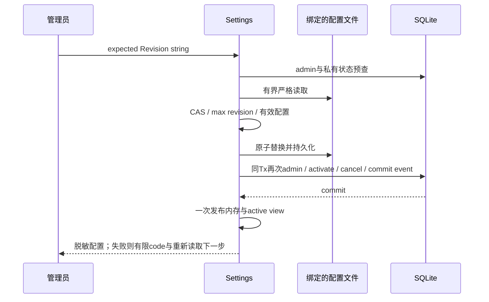

# S3d1：显式凭据恢复后端实施计划

2026-10-15，codex/sidebar-workflow。Confirmed requirements、repository-recovery-contract及S3实施计划中的reload合同为输入；补齐backend操作/状态传播，不启用生产绑定，不缩减原生多平台、发布和完整REQ/AC。当前P6→P7/P8，F3，UI在后续S3d2接入现有设置页，不新增侧边栏入口。

## 问题与用户流程

配置已替换但DB/内存发布失败时，普通Save被禁止，管理员需要读取实际已保存文件重新完成激活。先GET当前内存配置与有限状态，手动POST精确Revision；失败后只重新GET，不自动换版本重发。进程重启路径继续保留；此操作不探测远端、不发送消息或执行仓库代码。

## 公共字段和API（新增，尚未实现）

GET /settings及成功保存/恢复的settings对象仅在已绑定激活器时附加只读repository_activation：state=active/pending/unavailable，code有限字符串，can_reload bool。默认未绑定省略整个字段，避免提前开放空入口。状态必须核对当前Store绑定与健康DB私有state；无法核对返回unavailable/can_reload=false，不把DB异常猜成已损坏或恢复成功。只公开操作可用性，不公开generation/epoch/key/fingerprint/token/文件内容。

POST /api/v1/settings/repository-activation/reload：既有admin/session/同源CSRF。body≤1KiB、UTF8、单JSON、精确单key expected_config_revision，值是无前导零正uint64十进制字符串。重复/大小写alias/未知key/null/number/overflow拒绝。expected必须等于当前有效内存Revision；客户端不能选择下一代次或文件路径。200 settings对象和有限状态；400 invalid_activation_request/invalid_configuration；401/403既有权限/permission_changed；409 settings_changed或activation_version_exhausted；503 credential_activation_pending/unavailable。所有底层file/YAML/SQL错误固定脱敏。

## 文件与状态合同

只读SettingsService初始化绑定路径的普通文件，读取≤1MiB+1，超限/非UTF8拒绝。reload仅支持无anchor/alias/merge的普通单文档YAML、唯一字符串key、有限depth/node数及KnownFields；本程序保存的YAML符合此格式。原OpenSettings启动兼容语义不改变。系统config_revision只接受十进制integer节点，缺失/0按既有规则为1；拒绝字符串/float/负数/overflow。全局原默认值提取共享helper，不复制另一套默认配置。文件Projects不成为权限来源，使用当前有效Settings项目快照，outbox保持原dirty与版本对账。

锁Settings.mu→有限Store事务。读取/解析/规范化与当前CAS/admin预查先完成，再计算新Revision=max(current,file)+1，MAX拒绝不回绕。新凭据material来自实际SDK/代理；正常未变material保持旧active，pending恢复维持gate，material改变先旋转epoch/pending；写文件→同Tx再次核对admin/持久state、激活/取消→一次发布完整内存。失败后文件可能已替换则pending、内存保留旧值；不回写旧文件假装失败未发生。缺/坏key不能恢复重建。

只要DB提交，追加settings.reload.committed事件（actor与精确新Revision），和generation/取消同一事务；该事件表示DB提交，不冒充内存发布已成功。发布前失败可保持pending；重放旧expected若已经发布则409且零写，若仍pending则可手动同请求恢复，相同material不重复推进generation。事件是每次实际commit，不把commit后发布失败当从未操作。只有这一HTTP/admin操作携带私有commit上下文，普通系统/启动激活不添加伪用户事件。

## 模块、门禁与验证

narrow_fix/adapter_extraction：settings_file_decode.go提取原默认值并严格读已保存配置，repository_credential_reload.go负责CAS/恢复/状态DTO，http_repository_activation.go负责body/状态码，routes.go只委托有限错误与增加admin路由。activation核心只消费私有reload commit上下文，禁止把HTTP或用户JSON解析塞入核心。无DB schema/PolicyVersion改变。

真实Go/SQLite/HTTP验证：pending后恢复；A→B→A；同文件不重复generation；旧fileRevision与>2^53精确CAS/MAX；空token不沿用内存密钥；项目不导入；响应丢失后409零写；file/DB/commit-before-publish失败与再次同key；admin在commit前撤权；坏key零文件写；未绑定、非管理员、跨域、重复/alias/尾随JSON、超限YAML/未知/重复/多文档/alias拒绝；所有响应不含秘密。仅临时配置与httptest，不外发。

F4/F5需全Go/race/vet/build/typecheck与新精确HEAD CI。S3d2须接入既有设置页、丢弃草稿/手动恢复/未知响应锁定和SafeInteger门禁，不能先展示不能用的按钮。C3 singleton owner及S4 producer未就绪前main不绑定，用户所要求原范围继续保留。

## 2026-10-16实现前补充

公开settings与activation状态基于同一内存配置Revision；观察到view/配置Revision跨更新不匹配时返回unavailable/settings_changed/can_reload=false，要求重新读取，不把混合观察授予恢复。Public脱敏从同一快照构造has_*标记，避免多次Snapshot混合。

公开readonly字段不能用于普通PUT授权；前端Settings类型同步声明status字段，普通保存payload显式移除它，后端仍拒绝activation/counter输入。此为必要契约传播，无新按钮；完整恢复UI属于S3d2，生产未绑定时状态字段省略。若修改前端payload源，正常生成资源并验证embed，不能留下旧bundle。

恢复的admin先在读取/文件替换前核对，再在激活事务核对；SQL错误不猜成权限撤销，统一不可用。role改变时不提交代次/取消/event；文件若已替换仍保持pending，由当前管理员处理。成功DB事件名为settings.reload.committed，只表示该版本提交，不冒充发布内存成功。

状态code枚举：active为空字符串；pending为credential_activation_pending；unavailable为credential_activation_unavailable或settings_changed。无新增持久对象或schema，状态由现有view/DB即时投影，reload事件沿既有保留规则。子请求10秒上限，状态观察2秒上限；文件YAML最多64层/100000节点。回滚保持旧二进制/配置/数据库的既有配对约束，不由reload恢复schema。
