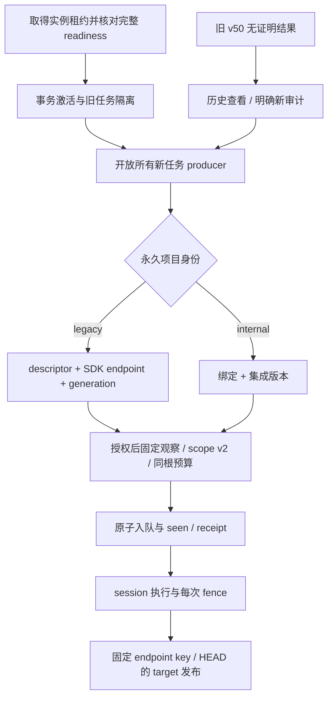

# 普通 GitLab 项目：固定身份与发布切换合同

状态：F2/F3 作者修订稿，未实现、待复审。2026-10-16，codex/sidebar-workflow；处理 NTR-006。输入为 Confirmed REQ-001–023/AC-001–021，不改变 PR、多语言、跨仓及默认 Git/API-only 范围。本文修订 execution/runtime/publication 中“新 legacy 仍 v50”与“新发布必须 scope”的冲突；不是通过放松发布校验解决问题。

## 工作流及边界

P6 设计修正；允许修改合同，生产代码暂不实施。相关模块为 scope/parser、activation descriptor、factory/admission、各 producer、session transport、ledger、两个 outbox 和原 webhook/poll。无新增菜单，无实际外部发送，不合并 main。原生产未绑定 activation 的阶段继续当前行为；不能部分启用 C3。

## 新旧任务与切换

正式启用后的所有平台新任务使用 `eino-audit-contract-v51`，不再由“是否显式绑定”决定 v50/v51。普通 identity.kind=legacy 的 GitLab 项目也从当前激活 descriptor 构造新观察与 scope，绑定项目走 integration reference。HTTP 不提供版本、principal 或 endpoint。v51 必须具备固定 scope v2、预算及同事务映射；不能新建无证明任务再让 publisher 例外放行。v50 保留为历史/切换前策略，不改写其 policy。

手工 Submit、原 `/webhook`、native hook、poll、Slack reaudit、followup 的新根任务全部走工厂；legacy 名称仅决定 reference 的凭据/endpoint 来源。原 webhook 的 secret、项目启用检查及 service principal 验证保留，不能复用 native 集成 secret。v51 自动 retry 保留父 scope/预算/版本并重新验 fence。v50 的明确人工复审是新根，重新观察并生成 v51；不是复制旧 policy。v50 自动 retry 不跨正式切换启动，无凭据证明时保留历史/明确停止原因；不能借此重新发布旧结果。

切换是停机部署后的单一启动路径：取得 worker instance → 确认 schema3 和完整工厂/新旧 producer/发布 adapter readiness → 同 owner 事务激活凭据及既有取消规则 → Recover → 启动 loop/HTTP。readiness 不是用户开关；缺任一组件则启动失败，不先开 HTTP 或让旧 producer 混入。迁移/启动不发送消息。第二实例不能旋转代次或取消任务。

已有无 scope/generation 的 pending/running 按激活取消规则终止；旧 completed 结果继续查看，未发布/unknown 不补当前代次、不能认领为新任务。已发布的旧远端对象不自动迁移 target：没有充分归属证明时保留历史，不借新运行悄悄 PATCH。用户明确新审计可以新建新协议目标，需在 UI 区分历史发布记录；这是一次切换边界，不宣称能够无证据接管旧帖子。回滚恢复一致程序/DB 备份，不降 schema 后继续执行 v51。

## Scope v2：endpoint 联合类型

scope v1 保持原校验、原字节语义和历史查看，不能重新解释其 origin。新 v51 producer 统一生成 v2；consumer 显式分版本，未知版本拒绝。仍是 target/source/context/observation，原身份、SHA、ACL、16KiB 总上限、context≤4 和重复仓库约束保留。新增 legacy endpoint 仅 v2 可用；不放松 RepositoryBinding 的 HTTPS origin 语法。

| 字段 | 类型/必填/默认 | 来源及验证 | 兼容/所有者 |
| --- | --- | --- | --- |
| scope.version | INTEGER，必须为2，无默认 | 正式 factory producer | v1 仅原语义；旧二进制由 schema guard 阻止 |
| reference.api_origin | string，必须 | integration 保留 v1 规范 HTTPS origin；legacy_gitlab 必须为空串 | 空串只在严格 v2 legacy union 中合法，不是 fallback |
| reference.legacy_endpoint | nullable object，新字段 | integration 必须不存在；legacy_gitlab 必须存在 | consumer 不从当前 Settings 修复缺字段 |
| legacy_endpoint.config_url | UTF8 string，必须，≤2048 bytes，无默认 | descriptor 固定 Settings.GitLab.URL，validURL；无 userinfo/query/fragment，HTTP/HTTPS，保留有效 path/escaping | 无 token/proxy；来自管理员现有配置，不来自 PR/模型 |
| legacy_endpoint.api_base_url | UTF8 string，必须，≤4096 bytes，无默认 | 用固定 config_url 调同版 NewGitLabRepository 构造 SDK（零网络）取得 Client.BaseURL().String()，精确相等 | 不拼猜 `/api/v4`，不丢前缀/改协议 |
| legacy_endpoint.transport_policy | string，必须 | 固定 `legacy_fixed_session_v2`；未知值拒绝 | 其真实网络属性单独显示，不能宣传 native allowlist |
| credential.legacy_repository_revision | 正 int64，必须 | 当前 active descriptor 的持久 generation；其余 integration 字段为零 | epoch 不代替持久 generation；切换不回填旧任务 |

legacy reference 仍要求登记 kind=legacy/health=valid、identity_revision 一致、binding_revision=0、provider=gitlab、remote_id=内部项目 ID；project API 返回 ID 与真实 path_with_namespace 必须匹配。本次 prospective 远端验证可以证明新任务，不依赖不存在的历史 origin 登记。full_name 仅路由元数据，不代替 ID。internal/repair_required/已有绑定的项目不能借 legacy union 逃回全局凭据。

每个 v2 reference 派生 `EndpointKeyV1`：固定 struct JSON `{version:1,provider,api_base_url}`，UTF8、固定字段顺序、无尾 LF；≤4608 bytes。api_base_url 来自对应 SDK 的真实 API base（integration 由其规范 origin 构造，legacy 使用上表）；仅 endpoint key 中将 scheme/主机小写、去其对应默认端口，IPv6 保留括号；path 大小写、转义和尾斜杠严格保留，不 decode/clean。派生 key 不修改发送 URL。等价的 HTTPS-root legacy/native GitLab 取得相同 key；不同有效前缀不会混仓。测试以同版 SDK 构造出的 wire URL 证明这些规则，不能只测字符串。

远端身份比较使用 `(provider, endpoint_key, remote_id)`，不使用空 api_origin 作仓库键。scope target/source 必须 endpoint_key 相同，context 可不同；同远端不得映射到两个内部 ACL ID，source/context 重复必须全 reference 一致。key 为派生公开地址信息，不是 secret hash；API/错误仍不外泄内部 endpoint，日志用有限分类。

## 准入、读取与发布

BeginAdmission 捕获同一个 active descriptor/config/generation，校验 legacy target ACL/登记；先以固定 SDK 取 MR/project 元数据，在 source 授权前不读 source commit/tree/blob/compare。普通 source/context 必须各自有启用登记及权限；不能把可公开访问等同于授权。scope、context 投影、预算、当前代次在 Attach 同事务重新验证。配置在观察期间变化则零新 run/seen，旧 descriptor 不换成新 token 继续。

OpenRun/Auxiliary 对 legacy v2 逐项比较 descriptor generation、config_url/SDK base/transport policy；HTTP 派发、body 消费、缓存、Git 命令和模型输入都沿同 fence。对象 API reader 使用冻结 SDK base，支持 HTTP/path prefix；固定 OID/raw/diff、预算、覆盖缺口与既有 API diff 合同相同，不改用动态 branch。Git/API 模式均走同账本和资源会话，不为普通项目另开无限额 reader。

Git 子进程仍只访问本地 reverse bridge，经强制 forward proxy 与完整白名单环境，零上游 token。legacy bridge 的远端 clone URL 来源于已验证 project API 的 HTTPURLToRepo；无 userinfo/query/fragment，只接受固定 API base 的相同 scheme/Host，逐 reference 固定路由，不从 api path 推导 clone path。无重定向或任意外部 helper。该来源与当前 PrepareGitLab 同一身份约束，不能因 HTTP 改用 HTTPS 或删路径来通过校验。

Go 侧 legacy transport 保留管理员配置的 HTTP/HTTPS 和其已激活代理选择；有效 proxy（含秘密）仅在 descriptor 私有内存，不写 scope/key/日志；请求使用同一固定代理，不能继承 Git 子进程或读取变化后的环境。material 检查必须覆盖实际 API 与 clone route 的代理结果；有差异则拒绝该 session 并提示重新加载，不发 token。此为新的legacy_fixed_session_v2；其DNS/私网授权范围沿管理员legacy配置，不伪称受native CIDR限制；新增integration仍采用原受限HTTPS/DNS/CIDR transport。两者均在实际dispatch/stream扣同账本、复查fence，无重定向。不会将不兼容地址静默切换到另一profile；明确失败与真实兼容回归测试进入发布前验收。

### NTR-007：material 与实际 transport 同版本切换

`legacy_http_default_v1`只表示现有旧reader及旧material；新scope/会话禁止使用该值。新增私有material producer `newLegacyFixedSessionMaterial`，严格固定struct字段顺序：Version整数2、TransportPolicy=`legacy_fixed_session_v2`、BaseURL=实际SDK base、Token=精确UTF8、Networks=[]、Proxy=对该base解析的有效代理字符串或空。token/proxy只参与原HMAC私有material，不存scope/公开DTO。沿既有32-byte安装HMAC key与generation CAS；不能复用旧producer再只改scope文案。

新profile语义同时包含：SDK固定API base、捕获proxy供API与clone使用、禁止重定向、每次dispatch/stream和缓存复查fence、Git仅访问本地受控bridge且上游token只在Go内存。header/预算/资源限制仍沿对应合同。选择profile来自已验证服务端readiness/程序版本，非用户或HTTP参数；scope、descriptor、material与实际client任一profile不一致都零dispatch，不fallback v1。

C3首次启用、Settings.Save、显式Reload及启动重建descriptor统一调用新producer；不能startup用v2、之后Save又写回v1。旧→新profile在URL/token完全相同时仍改变material，事务推进generation并隔离旧任务/outbox；generation耗尽按既有exhausted错误停止，不复位。新profile同实际输入重启/非凭据保存不推进generation。旧指纹仅作为迁移前状态比较，不作为v51授权；回滚须恢复一致程序/DB备份，不让v2降级v1继续旧任务。代理差异检查使用相同捕获resolver和实际route，clone需不同代理时拒绝，而不是借新代理重派旧token。

新增验收：v1→v2同URL/token只推进一次，v2重启/模型保存不推进；Save/Reload不降级；API/clone记录的proxy确实相同、302零跟随、错误scope/material profile零dispatch、代理变化/耗尽/事务未知保持既有pending与恢复语义。现有v1测试不作为这些测试的替代。

所有新 v51 run 的 comment/check 消费完整 v2 scope。legacy_gitlab 通过固定 generation/config 使用 GitLab publisher，integration 逐 reference 取集成凭据；不再通过 outbox native 字段 NULL 选择旧全局客户端。新任务共用 target/claim/未知回执协议。publication target 的唯一键以及 OwnedContentV1 的仓库字段使用 endpoint_key 替代 api_origin，版本1尚未生产启用，无需伪造线上投影迁移。旧 v50 outbox 新字段仍 NULL且仅历史协议，不能拿来授权新的外部写。

native hook receipt/seed 的身份也明确用 endpoint_key；该路由只接受绑定项目，legacy 原 webhook 进入同 factory 的 service source 证明但不伪造 integration_revision。poll baseline/PR state 同样使用 endpoint_key 隔离 remote，legacy 不再复用 platform_poll_seen 作新 v51 基线。baseline 从既有 scan_existing 选项明确初始化；旧 seen 不回填为 v51 已准入证明。schema3 表 key 的新规范须统一改 producer/SQL/index/GET/projection/tests，不同时保留两套可择优的身份键。

### 后台主体与原 webhook 的字段传播

budget principal 的版本1尚未生产，service对象改为 `{version,kind,source,project_id,repository_authority,receipt_id?,run_id?}`，不再强制顶层binding_revision/integration_revision。repository_authority严格二选一：integration为`{kind,identity_revision,endpoint_key,remote_id,binding_revision,integration_id,integration_revision}`；legacy_gitlab为`{kind,identity_revision,endpoint_key,remote_id,legacy_repository_revision}`。所有ID/代次为规范正十进制字符串，key为上述固定JSON字符串；无未知字段，原principal≤8192bytes。source用途、user principal、actor列CHECK、receipt/run约束沿budget合同；不能仅因kind=legacy或requested_by=0授予服务权限。

原webhook验签后也写同一有界receipt队列，source=legacy_webhook；native路由为source=native_webhook。receipt增加source与repository_authority_json/digest（版本1、≤8192bytes），旧表格的顶层binding_revision/integration_revision仅integration分支有效，legacy为NULL而非假正ID。project/provider/remoteID列必须与authority一致，api_origin列改endpoint_key。source/authority由已验证内部入口生成，HTTP不得提交。两类hook仍映射principal.source=hook，hook receipt的processing/admitted/同budget恢复规则相同；service恢复必须逐分支核对当前授权，不因某个revision字段不存在而跳过检查。

receipt去重scope为`(project_id,identity_revision,endpoint_key,remote_id,credential_kind,credential_revision,binding_revision_or_zero)`，再分别加delivery_key/body_digest唯一；credential_revision取该union的integration_revision或legacy generation。route/native binding revision仍核对，原webhook仍先按当前secret校验。已验签入队的job不因之后单独轮换hook secret被重新解释为未验签，source授权及repository代次则仍在执行前检查。receipt存储不是签名：仅可信接收事务写入，任何恢复路径不能从未验签原body补造authority。每个去重scope沿32非终态/100000容量上限；scope永久失效且任务/预算结束90天后才可整组清理，当前有效scope不按时间删除去重。

seed的target/source/context使用同v2 union，hook receipt authority只约束target，source/context仍须逐项授权。poll构造器消费当前reference authority且EnablePolling必须true，automatic_comment只能沿原run根principal；不是把三个source都改成任意service通道。验收包括原webhook与native route相互不能冒充、缺integration revision的legacy分支仍逐generation验证、旧secret重放拒绝、receipt已接受后secret轮换不伪造新run。

## 数据流与生命周期

scope/endpoint 随不可变 run policy 生命周期保留，不到期删除身份；预算沿原 close/abandon/保守预留。换 endpoint/token/proxy 使旧 descriptor/session 失效，旧 run/outbox 不借新配置继续；新观察生成新代次。target 的凭据变化不改变同 endpoint 的远端对象身份，endpoint key 改变则新 remote target；晚回执仍沿原冻结 attempt 结算。公开 DTO 对 legacy_endpoint 仅权限允许的设置/配置视图展示，普通 run 列表不新增内部地址字段。

## 实施传播与验收

1. N1/Scope：严格 v1/v2 parser/clone/digest，v2 endpoint union；schema3 新 key/index，unknown/重复键拒绝。N2：legacy 路由真实 API/Git prefix 与 proxy/fence；不放宽 native binding。N3：同固定对象 adapter。N4：全部新 producer 统一 v51；N5：endpoint key 发布/基线与 owner 控制单次启动；N6：恢复/UI/readiness 后开放绑定写。
2. 用真实临时 SQLite + HTTP/TLS/CGI + 模型 fixture 验证未绑定普通 GitLab与绑定两平台从提交到发布；包含 HTTP、自定义端口、路径大小写/转义/前缀、同 host 不同 prefix、legacy/native 同 SDK base 的 key 一致及撤权。配置改 endpoint/token/proxy后，旧任务零后续读/发布，新任务用新 generation；第二实例零旋转。断言 API/clone 的实际目的地址与凭据，不仅错误码。
3. 同部署 hand submit/两种 hook/poll/Slack/followup/retry、context 混合 union、fork source ACL、v50 历史/新根、旧 unknown 不认领、发布失败都覆盖。自动恢复不生成无 scope 的 v50；无模型/远端真实账号发送。API-only 禁 Git PATH 仍完成。
4. 验证全部通过才能启用 C3。当前仅作者合同，不宣称已支持 scope v2/新普通 GitLab完整链路；仍须正式复审。真实账号、版本兼容和所有 REQ/AC 完成证据分别保留，不能由文档或 probe 替代。

## 本次作者修订的验证记录

Go1.27.2 本地执行 `go test ./internal/platform -run '^TestLegacyCredentialMaterial(UsesEffectiveSDKEndpoint|RejectsLossyAndSecretErrors)$' -count=1 -v`，exit 0，两测试通过。覆盖真实SDK BaseURL作为material来源、HTTP/path大小写、尾斜杠、token/代理变化与脱敏；测试构造客户端但不请求真实服务。此证据不证明拟议EndpointKeyV1的wire路由、scope v2或startup已实现。sonic在该Go版本回退encoding/json，测试正常结束。文档另执行diff空白与相对链接检查。
