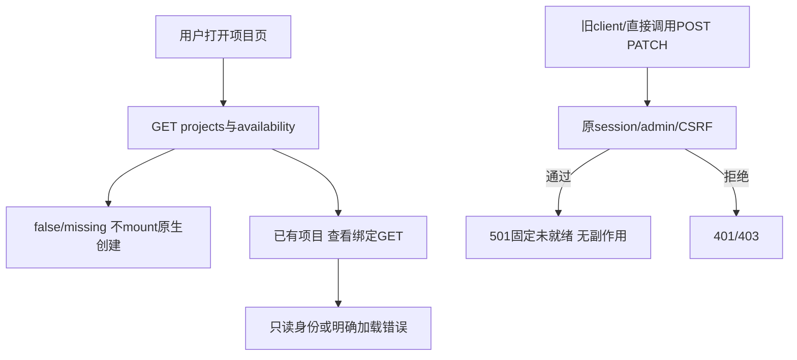

# 未就绪仓库管理写入口收口（F2/F3）

2026-10-16；codex/sidebar-workflow；输入为Confirmed requirements.md及用户“没想清楚先不实现”“审计为了做而做、不能落地的功能”。这是UAR-001的可达性缓解，不以隐藏入口代替完整GitHub/跨仓/S4–S6交付；全部原REQ/AC保留，UAR-001仍待完整执行与恢复闭环。

## Workflow Gate

- User request：最佳实践优化，停止开放未完成的功能链。
- Phase/task：P8/F2–F3，现有可用性缺陷的窄修复，HTTP+现有项目页。
- Upstream：Confirmed需求、practicality-audit-1d29ab8.md、当前绑定guard/Runner/CRUD/UI；已核实任一显式绑定会阻止legacy执行，newGitHubReadClient没有生产调用，POST/PATCH仍写DB。
- Missing：完整native factory/身份恢复，不能安全推断其可用。本片不启用它。
- Implementation allowed：本窄收口经独立技术评审后yes；原生factory仍no。
- Prework：本方案和评审分别提交推送；不改需求为“仅支持legacy”。
- Scope：项目列表加有限availability投影、两个HTTP写路由统一501、现有绑定面板只读、创建入口按availability关闭；不清理用户现有绑定/历史/草稿。
- Acceptance：新版UI不提供未就绪写操作；旧JS/直接HTTP也不能创建或绑定并暂停项目；读取/ACL、默认GitLab项目配置与审计保持；没有DB/config/outbox/run/远端副作用。
- Assumption：这些原生入口是尚未发布的功能分支能力，本次未授权部署/main合并，拒绝未就绪接口不改变已部署main合同。后续完整可用后再按正式producer/consumer恢复，不能以环境开关跳过验收。

## Maintainability / Feature Lifecycle

routes.go多职责，http_auth.go负责路由与权限；只加投影/委托，不增加业务SQL。独立http_repository_management.go负责固定availability和统一拒绝，binding文件保留只读GET。删除两个未就绪HTTP mutation实现，内部Store身份/receipt/同步方法保留并由Store测试验证，不能从另一HTTP入口调用它们绕过收口。前端Projects315行仅消费合同与编排，binding编辑器200行收敛为只读信息面板；不做无关UI重构。跨UI/HTTP风险high，allowed=narrow_fix/adapter_extraction，无需先大拆。每阶段载体本文件，F4/F5代码与验证记录独立提交推送；无发布。

## 行为与精确合同

### 项目列表（向后兼容新增）

GET /api/v1/projects 保留items并新增repository_management对象：

| 字段 | 类型/必需 | 值/所有者/校验 | 兼容 |
| --- | --- | --- | --- |
| repository_management.available | bool/required | 当前服务端固定false；不是Settings字段/远端可写flag | 旧client忽略新字段 |
| repository_management.reason | string/required | native_audit_not_ready，当前唯一有限code | UI未知/missing时不开放创建 |

无新持久对象/schema。投影不包含凭据、generation、URL或用户详情。来自实际当前未实现状态，不能因为凭据保存成功而变true；未来必须按完整factory能力重新评审才改。

### 未就绪写请求

POST /api/v1/repository-projects、PATCH /api/v1/projects/:id/repository-binding：保留原session/admin/同站请求middleware，授权和CSRF失败仍401/403；通过后固定HTTP501，no-store，JSON {error:固定有限英文说明,code:repository_management_unavailable}。这是明确拒绝，不是写入未知或sync_pending，不读请求body或调用Store/Settings/Runner/远端。

路径id非法也可以得到同一501（已经授权admin，接口整体不可用）；不从不存在/现有项目差异泄漏状态。GET binding保持原id校验、项目授权/404、只读binding JSON，不改shape。PATCH/POST既无成功也无可重放write receipt，不暗中排队等待未来factory。

原http_repository_binding.go只保留GET，删除saveRepositoryBinding实现；原http_repository_project_create.go删除，避免留下可再次注册而绕过硬gate的mutation handler。Store.SaveRepositoryBinding/CreateRepositoryProject不是远端接口，保留供迁移/受控测试和后续正式恢复；不能因此声称它们的未发布HTTP成功合同仍然可用。

settings与默认POST/PATCH /projects仍走原逻辑。ImportConfiguredProjects不接受新internal identity或bound ID当legacy创建，已有SaveLegacyProject/identity guard阻止转换；必须补反例，确保无法通过这些路径新建native binding或改写旧身份。

## 前端UX与状态

Projects列表资格函数仅接受对象available严格为true且reason严格为空字符串（预留完整ready状态）时展示原创建入口及mount创建组件；当前服务端只产生false/native_audit_not_ready。undefined/null/未知reason/类型错误/加载失败均不开放。当前false时admin看到简短“原生仓库审计接入尚未开放，已有绑定仅可查看”，不把false称作权限不足；member不增加管理提示。无需新增菜单。

绑定按钮改为“查看仓库绑定”，当前面板只GET项目binding，不读取/integrations，不提供draft/Provider表单/保存/丢弃草稿按钮。loading、error+手动刷新、empty legacy revision0、已有绑定identity/revision、关闭/键盘focus和窄屏保持。读取失败不能显示旧项目binding；项目切换/卸载Abort；401/403/404清除显示。绑定APIOrigin为已有服务端规范值，只作为文本，不自动导航。不返回或展示token。

原create组件/attempt本片不删本地持久草稿或主动读取；组件当前不mount，不能自动重放旧POST。未来恢复须按S6完整流程处理旧draft/idempotency。shared API error mapping为repository_management_unavailable提供明确中文“原生仓库审计接入尚未完成，目前仅可查看已有配置”，不能映射成保存结果未知。

## 数据流/生命周期

没有新数据生命周期。已有绑定保持不可变，历史身份与暂停状态不被伪装修复；没有DELETE fallback、清空绑定或猜远端ID。默认legacy配置仍可用，执行guard继续保护旧报告/权限。

## 实施顺序与文件

1. 新增http_repository_management.go，GET projects投影及路由委托；移除旧两个HTTP mutation实现。
2. http_repository_management_test.go使用真实Register/Login/SQLite验证匿名/member/admin/cross-site、响应code/no-store、未读body、零表/配置/网络变化，以及seed旧绑定后的GET原样可读/ACL。原两份HTTP mutation成功测试按新501合同替换，不保留绕过生产gate的测试开关。
3. 保留所有Store层create/binding/CAS/同步/重开测试；本片不删除这些底层能力的回归。GET已有ACL/身份投影的必要覆盖迁入新HTTP测试；不能靠删测试使检查变绿。
4. frontend api.ts新增精确响应type与error映射；Projects消费availability；binding面板改只读。创建组件不mount，无需改其未发布协议。纯availability predicate按缺失/未知/类型错默认关闭测试。
5. 最后完整typecheck/build正式assets；避免Vite写dist时并行Go embed测试。完整Go/race/vet/build及精确HEAD CI，本片无真实模型/平台/邮件/机器人调用。

## 验证与发布

定向HTTP/Store/race：有效旧绑定、revision0、无权限/不存在、创建/PATCH各种body一律已授权501且副作用0；伪造project.repository/internal字段不能绕过默认project保存；加载旧配置不改变身份；legacy审计入口继续受控运行。UI用本地fixture/browser验证false/missing/error、旧binding读取/无保存按钮、旧draft不触发POST、窄屏与键盘。正常legacy保存不受影响。

本片不新增Figma资产或设计系统，只收口现有页面状态；无迁移。回滚若恢复写路由会重新暴露已知断点，因此未经完整native能力验收不能将“删除gate”当普通配置回滚。整体验收仍需S4–S6，包括绑定→审计→结果→失败恢复；UAR-002/004及其余完整需求继续保留。

## F4/F5当前实现记录

按评审b8251d4实现共享501 handler和项目列表availability=false/native_audit_not_ready；删除两个未就绪HTTP mutation实现，保留原auth/admin/CSRF路由。内部Store create/binding/CAS/sync及其测试不变。前端资格要求true+空reason，创建组件不mount；原编辑器移除并改名为repository-binding-details.tsx，只读GET，无/integrations请求、表单或保存动作；删除仅用于旧保存成功提示的状态。默认GitLab创建及保存路径仍正常。

旧两份HTTP mutation成功/sync-replay测试随合同退役，替换为真实Register/Login/SQLite的新http_repository_management_test.go：全库行内容hash与设置文件/内存快照证明授权501无副作用，所有请求体均不读；旧binding/ACL、0revision、非法GET ID、默认project路由/配置导入旁路、旧身份执行guard保留。未使用test-only开启开关来绕过生产gate。

已执行证据：扩大Store/身份/guard/HTTP定向race exit0、46.083s；新增旁路后TestRepositoryManagement定向race exit0、5.335s。前端typecheck、repository资格2项及原settings10项测试、正式build均通过；初次assets为index-BxZh24F7.js/index-DcGHn71w.css。完整Go exit0、platform121.314s；vet/build exit0。完整platform race同一handle27243已exit0、381.129s。

实际CUA/IAB、合成HTTP fixture与已构建页面证明：无原生创建/保存/输入，已有绑定的六项身份文本可读；binding读取失败清除旧身份；缺cap仍无创建；慢加载可关闭且焦点回原按钮；403只显示错误；360px document width=360无横溢，Tab到关闭按钮。fixture GET记录无/integrations、writes=[]；截图/tmp/aim-repository-readonly-mobile.jpg。临时tab已关闭、viewport已reset；没有真实平台/凭据/模型/邮件/机器人请求。

另发现项目请求失败时旧Empty文案仍提示创建多平台：已修正为error不显示empty，真正空列表仅提示默认GitLab。该最后UI文案需要最终build和受控browser复验；避免Vite修改dist与仍运行的Go/race并发，等待同一handle终态后再构建。新fixtures支持empty，并处理主动关闭时BrokenPipe，源码可复现；本轮一次写入脚本工作目录误设frontend未改动文件，改正根目录后完成，不把失败当验证通过。

当前源改动尚未提交/推送，等待上述终态与最终构建/页面复验；此前研究代码b2cd0bd的CI38844119652已completed/success，不借它替代本修改精确HEAD CI。UAR-001只缓解新增写入口可达性，现有暂停绑定的执行/恢复及完整S4–S6仍open。

## 最终验证与F6窄范围复核

Go后端生产代码自定向和完整测试起未再改变。Go全量platform121.314s、平台全量race381.129s、vet/build均通过；最后仅修前端empty/error文案，等待race终态后重建正式assets index-AzkuonZR.js/index-DcGHn71w.css，并再次go build ./...通过。没有Vite与Go/embed检查并发。前端资格2项和原settings10项测试通过，最终文案typecheck通过。

最终构建浏览器复验：empty仅提示“可添加默认GitLab项目”；projects_error无empty提示、创建/绑定按钮均0；正常模式旧绑定可读，360px无横溢，键盘focus到关闭，最终fixture writes=[]、integration GET=0；截图/tmp/aim-repository-readonly-mobile.jpg对应最终构建。临时tabs已关闭、viewport reset、所有18777 fixture已停止；无真实远端操作。历史localStorage草稿没有预置浏览器重放测试；现有create组件不mount及其无模块顶层写逻辑的静态复核证明不主动重放，不能把此项说成已实测恢复旧请求。

删除的是尚未发布且当前不可执行的HTTP mutation handler与其旧成功合同，底层Store协议/迁移/CAS/receipt/sync回归保持；新增真实HTTP测试证明全库行hash、文件和内存配置完全不变。schema无变化，无新增启用flag。新字段已沿Go projection→JSON→TS type/predicate→页面→Node/HTTP测试及CI传播，旧/malformed能力响应默认关闭。浏览器过程中发现并实际修掉了error冒充empty及旧多平台引导文案，不以源码推测代替最终页面证明。

本片可提交功能分支并独立验收精确HEAD CI，不合并main/部署。全功能仍不可合并声明完成：UAR-001只缓解新的写入口陷阱，既有绑定审计/身份恢复、S4–S6、UAR-002/004及完整REQ/AC仍open。没有以收起功能替代完整最终目标。

### 提交/CI追踪

ea25ab59f56507a4fc629713f38a55774f8f9299已推送codex/sidebar-workflow。[精确代码CI38847438292](https://github.com/Ed1s0nZ/AIMergeBot/actions/runs/38847438292)已实际查询in_progress、conclusion为空，不借前一b2cd0bd成功代替；后续观察同一handle。本条仅文档更新，不修改受测代码。未合并main、发布或部署；完整目标仍未完成。

后续查询：CI38847438292已completed/success，HEAD精确为ea25ab59f56507a4fc629713f38a55774f8f9299；Go全量/race/vet、operations、漏洞、前端（含repository资格）及embedded build全步骤成功。此窄修复的远端验收完成；S4–S6与完整原生审计/恢复仍未完成。
