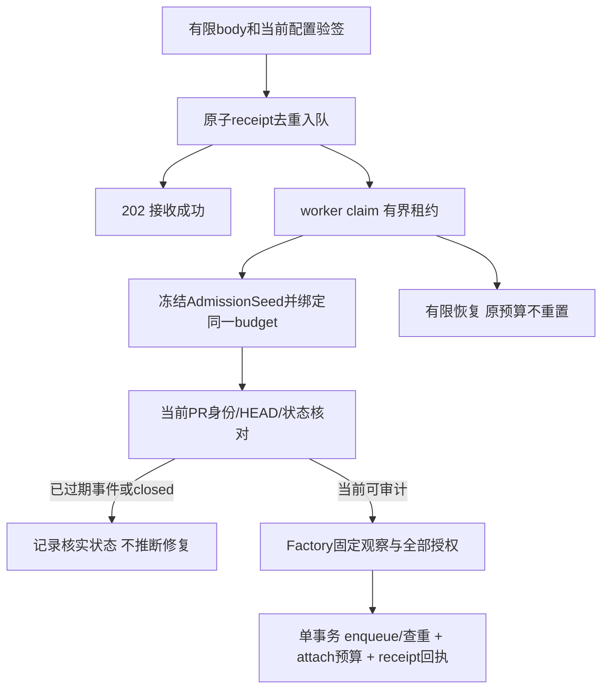

# 原生Webhook与发布合同（N5作者稿）

2026-10-16；codex/sidebar-workflow；输入Confirmed requirements.md、native execution/budget/resource合同和现有comment/check outbox。P6/F2，跨HTTP、Store、worker和外部写；本稿只设计，不发送真实消息/检查、不部署、不开放管理入口。所有新表属于尚未实施schema3，完整方案仍待技术评审。模块拆分native_hook_http/store/worker、native_publication_target/store、github_comment/check协议；原Runner只委托，不将验签/SQL/协议混入一个文件。

## 对外入口和验证顺序

`POST /api/v1/repository-hooks/:project/:binding_revision`为native接收入口，旧`/webhook`继续只服务可证明的legacy GitLab。project/revision为规范正十进制；路由不含token。body最多1MiB，读超限413；只接受application/json，无Content-Encoding，重复/矛盾身份字段拒绝。读取当前启用项目/绑定和对应凭据revision，但未验签前不发远端请求、不写可信事件。

GitHub使用原始body的HMAC-SHA256，严格sha256=64hex并constant-time核对；Secret复用服务端IntegrationCredentials.Secret，空值表示未配置Webhook。只接受pull_request事件及opened/reopened/synchronize/closed action，核对repository.id、PR号、base repo和source/head身份。GitLab核对当前集成Secret对应X-Gitlab-Token，event/object_kind/action与绑定project ID，不能用全局legacy secret接受native任意仓库。签名/secret错误统一401，不返回仓库是否存在。

GitHub X-GitHub-Delivery必须为规范UUID；GitLab优先规范X-Gitlab-Event-UUID，旧版本缺失时用body digest作delivery_key。传入header本身不是权限依据；HMAC签body不等于签delivery header，必须同时按原body SHA256去重，不能只防同delivery ID重放。action未知时验签后200 ignored，不触发审计或占用可信待处理队列。

HTTP只提交持久队列后返回202，body仅含receipt_id/state/可选run_id；不等待模型或远端PR元数据。重复合法事件返回原receipt，不新建预算/run；相同delivery key配不同body返回409。DB失败/待处理上限返回503，不假称已接收；每绑定最多32个非终态、100000个活跃版本receipt，超限给有限诊断，不删除去重证据换成功。

## 新增持久对象

关系型project/run/receipt/target/远端ID、revision和epoch为正int64；budget_id仍为64hex，namespace为既有32hex，claim_owner为服务器随机hex，不能混作数值。跨HTTP的新receipt/target ID用十进制字符串，避免JS精度损失；旧run ID保持既有兼容。时间为服务端UTC；无业务默认的必填列不以0/空值伪装有效对象。

| 表/字段组 | 类型/必须/来源 | 不变量与生命周期 |
| --- | --- | --- |
| platform_native_hook_receipts.id | INTEGER PK | 服务端生成，不作为认证凭据 |
| project_id/provider/api_origin/remote_id/binding_revision/integration_revision | INTEGER/TEXT/正ID，必须 | 由当前已验证绑定取得；provider有限github/gitlab；凭据更新不让旧job借新token执行 |
| delivery_key/body_digest/event/action | TEXT，必须 | key<=128、digest64hex；unique(project,binding_revision,delivery_key)及unique(project,binding_revision,body_digest)，跨integration revision保持去重 |
| envelope_json/envelope_digest | TEXT，必须，<=4096 bytes | 严格版本1：number、action、target remoteID、source remoteID（closed可0）、完整base/head SHA（closed可缺）；不存body/标题/URL/源码/secret；digest验证数据库内容未被误解释 |
| state/code/run_id | TEXT/TEXT/可NULL FK | pending/processing/admitted/ignored/failed；有限code；admitted必须有run_id，closed/ignored禁止伪造run |
| budget_id/attempts/claim_owner/claim_until | 可NULL FK/TEXT/INTEGER | pending首次claim前无budget；最多3次claim，30s lease/5s心跳，旧owner不得落状态；budget一旦绑定不可替换 |
| created_at/updated_at | TEXT，必须 | 不按payload时间排序授权；终态重复请求不重新激活 |
| platform_native_pr_states | project/provider/origin/remoteID/number复合PK；state/open-closed-merged；observed_head/observed_at | 只存当前远端核对结果，不直接按乱序payload改状态；不改变finding为fixed |

当前绑定版本终态receipt保留去重。只有该binding revision已永久失效（单调版本不会重用）且所有job/预算结束至少90天后，才允许整组归档/删除旧版本receipt；不能仅按时间删除当前版本去重。32/100000为初版有限容量，不代表吞吐最优；处理满额需要诊断与明确配置版本运维，不静默删表。

## Worker、准入与恢复

首次claim同事务创建budget并保存AdmissionSeed，之后才能远端读取。Seed为内部严格版本1、<=64KiB的非秘密JSON：冻结核心AuditPolicy（此时repository_scope尚未完成）、target/source/context references及context集合digest、service principal、预期number/base/head/source ID。所有reference来自本地已授权绑定，不从payload URL构造；缺少source绑定的opened类事件直接failed，零source内容读取。存入budget新字段admission_seed_json/digest；没有seed的预算不能由hook重领。closed仅需要target元数据，使用poll辅助profile，不Attach审计run。

worker重新取PR/MR：payload head/source与当前不符则ignored/stale，不审计错误旧提交；closed事件也先查当前状态，不用晚到的closed覆盖已reopen。opened/update在同HEAD同policy已有run时，Store查重返回该run并同事务更新receipt，当前admission消耗保留且关闭，不给旧run追加额度。基线/合并去重只表示PR处理状态，未再次观察不自动等于修复。

临时限流/5xx/网络错误最多3次claim，均使用同一root counter/limits/seed；新worker只在原admission绝对deadline尚未到、旧owner lease已失效时CAS新owner并递增session_epoch，旧owner不能Attach/读/退款。audit绝对窗口仍min(policy timeout,60)s，poll按其15s；恢复不延长窗口，不把未知reservation退款。普通HTTP同步准入不向外暴露budget重领权；RecoverHookAdmission只能经持久receipt精确关联和当前worker实例调用。修改budget合同的这一例外必须与实现一起审查，不能只更新job state却遗忘ledger。

每次retry先结束当前只读attempt，原子把job从processing移回pending并失效旧admission owner/epoch；attempts在下次claim增加，等待Retry-After不得超过原绝对deadline。root仍admitting且绑定非终态hook时，通用budget recovery不得仅因lease过期先标abandoned：应交给受限RecoverHookAdmission，或者deadline/配置失效时同事务终结job/root。出现active/root_run_id非NULL而receipt非admitted是违反原子协议，诊断失败而不是重领。此顺序进入Store.Recover和worker启动测试，不留两个互相竞争的清理器。

seed/context集合、binding/integration revision、权限、凭据代次任一不再匹配即failed，不能用新配置默默替换。预算耗尽、绝对deadline或claim次数耗尽是明确failed，不新建root无限重试。用户可经现有审计提交入口明确发起新操作，或由已启用poll发现仍未审计HEAD；终态receipt重放不再次自动入队。S6在现有绑定详情/诊断显示最近receipt状态、PR号、有限code和run链接，失败提供预填提交入口（仅导航，不自动POST），并区分“接收成功”和“审计成功”。

管理端集成DTO新增可选只读has_webhook_secret（github/gitlab由c.Secret是否非空计算）；既有has_secret包含Token，不能用它推断Webhook已配置。旧响应缺该字段显示未验证，保存时客户端不得提交该派生状态。GET /projects/:id/repository-hook-deliveries?page/size为现有配置内的诊断数据，operator及以上且当前项目授权，size<=20，按id倒序，返回receipt十进制字符串ID、state/code、PR号、created/updated、可选run_id；不返回digest/envelope/claim/budget/secret/原payload。列表/总数同只读事务，权限/错误/空/加载/分页按现有页面模式处理。不是另加空菜单。

Store的native enqueue与receipt.admitted/run_id/claim fence必须同一个SQL事务；崩溃不能出现已入队却无法通过receipt找回的第二次创建窗口。seed、关联budget或receipt冲突全部失败，不通过查猜最大run ID修复。手工/并发poll查重仍由既有完整snapshot+policy digest唯一性承担。

## 摘要与检查的持久目标

现有outbox以run为主键；native不能因此为每次同HEAD审计都创建另一个未更新的检查，或让旧摘要覆盖新运行。新增platform_native_publication_targets，已有两个outbox增加nullable native_target_id/native_target_generation；legacy行保持NULL和原协议，不给旧remote_id换provider。

| target字段 | 类型/必须/来源 | 不变量 |
| --- | --- | --- |
| id/kind | INTEGER PK；comment/check | 服务器产生；kind不是客户端开关 |
| project_id/provider/api_origin/remote_id/number/namespace/head_key | 当前授权远端身份；namespace现有安装随机值；head_key comment为空、check为完整HEAD | 复合unique；binding/credential revision变更不丢弃同远端对象身份；远端repo变化使用新目标 |
| desired_run_id/generation | FK/正int64 | 同PR最新run仲裁后CAS更新；generation不回退；native outbox绑定该generation |
| state/remote_object_id/remote_author_kind/remote_author_id | uncreated/ready/sending/unknown/conflict；可NULL正ID；user/app | 未ack前不伪造remote ID；GitHub检查记录真实回执app ID，评论记录真实author user ID；不能仅凭公共marker认领别人对象 |
| ack_hash/attempted_hash | 可NULL SHA256 | 使用确切有限request bytes；含run/generation/HEAD身份；不同generation不能碰巧同body |
| claim_owner/claim_until/updated_at | TEXT/UTC | 与per-run outbox claim同事务；发送期限20s、租约60s；过期sending变unknown，不能直接reclaim为一次新创建 |

claim时同时锁目标与outbox、复查当前desired generation/全部snapshot权限及配置。网络在事务外，写前再次fence；已dispatch后失去权限/代次时记录unknown，不称“未发送”。native caller使用冻结reference的remote ID/凭据，不走全局GitLab client。已知remote object GET确认身份后才更新；404/作者或marker矛盾是conflict，不自动另建。

unknown create没有可信remote ID时不自动再POST。评论仅在完整有界列表中找到唯一“同已核实author+精确namespace/PR+attempted body hash”的对象时可只读对账；无/多候选或不完整分页仍unknown。Check Runs若没有可核实app身份，公共external_id/name不足以认领，保持unknown并人工核对。已知ID的unknown更新可读核对精确attempted hash后确认已应用；仍为前一ack hash时不能证明迟到请求不会应用，因此不盲PATCH。没有显式可靠恢复语义的路径保持禁用，不增加“强制重试创建”按钮。

## GitHub协议和内容边界

写API固定2022-11-28，和现有read client一致；每条请求明确Accept/API version，实际支持与权限由诊断/受控协议及真实服务验收分别证明，不能只看token保存成功。GitHub summary使用issue comments：GET列表/GET已知comment、POST /issues/:number/comments、PATCH /issues/comments/:id；不是inline review comments。使用原body marker理念，精确绑定安装namespace/目标PR及run generation，comment正文最多32KiB，只发送已验证主仓发现摘要和平台内部链接。

**有context仓库时只允许通用任务状态与工作台链接**：不外发发现数量、描述、代码、来源仓库/路径或内部引用；检查conclusion仍按已授权发布策略表达通用结果。保留现有跨仓publication guard的数据边界，不能因为publisher本人能读所有仓库就认为PR的所有读者也有权限。无有效PublicURL且无法产生可用安全链接时明确blocked，不发送不可定位的占位摘要。中性说明、缺口与失败不得写成“安全”。

check name固定aimangebot/<namespace>/project/<id>/pr/<number>，external_id为有限目标ID+generation+run+完整HEAD，创建/更新前后都核对repo/HEAD/name/已知app ID。POST /check-runs首次创建，后续同HEAD已知ID PATCH；返回201/200及完整身份、期望status/conclusion才算published。old generation不能更新当前目标；不同HEAD不会复用ID。回执pull_requests为空不直接视为错误，fork场景按实际repo/HEAD验证。

| 本地期望结果 | GitHub status/conclusion | 解释 |
| --- | --- | --- |
| 队列/执行中 | queued/in_progress，conclusion省略 | 仅有真实对应运行才发布 |
| 成功且阈值风险0 | completed/success | 不宣称证明绝对安全 |
| advisory有风险、skipped | completed/neutral | 不用success掩盖风险或未审计 |
| blocking阈值命中 | completed/failure | 与现有checkStateForRules的阈值一致 |
| failed/incomplete | blocking且相应BlockOn开关为true则failure，否则neutral | 正文始终保留失败/覆盖不足，不转换成“通过审计” |
| cancelled | completed/cancelled | 不等于安全或已修复 |

人工fixed/false_positive不自动改远端门禁，UAR-002仍待独立语义确认。token只有read或classic PAT无法写Checks时显示权限/能力失败，不偷偷换commit status协议；不承诺GitHub App自动签发/刷新凭据。原GitLab publisher在native下使用正确source/target remote ID，保持MR pipeline/精确SHA规则；不能借GitHub映射改变legacy行为。

## 实施与证明

N5实施须同时加入schema3迁移、严格seed解码/ledger重领、hook queue及worker、publications target+两个outbox fence、GitHub协议和现有诊断/详情投影；新字段从producer到Store/DTO/TS/测试完整传播。清理旧receipt必须证明binding版本永久失效，不在N5自动删除当前namespace发布对象。回滚恢复一致DB与程序备份，不能清空unknown或删目标来恢复旧版本。

受控验收至少包括：验签前零外部/可信写，body上限，换delivery ID重放、同ID异body、跨revision与乱序closed；接收响应丢失、claim崩溃、admission已commit但HTTP未回应、3次/原deadline/同根额度；同HEAD同policy仅一run、counter不重置；两run争一个目标、迟到旧lease、unknown创建/更新、错误author/app/marker、分页不完整、403/5xx/201坏回执、无checks权限、fork空pull_requests、所有中性/失败状态、context摘要零内部内容及PublicURL缺失。

上述是待实现验收，不是已运行测试。本轮GitLab对象探针仅证明SDK/wire/hash/分页边界，不证明这些后台和外部写协议。当前管理写gate继续关闭；完成全S4评审和受控端到端、S5恢复与S6 UI后才开放，不发布真实评论/检查或自动合并。

资料：[GitHub webhook最佳实践](https://docs.github.com/en/webhooks/using-webhooks/best-practices-for-using-webhooks)、[issue comments](https://docs.github.com/en/rest/issues/comments)、[Checks](https://docs.github.com/en/rest/checks/runs)、[GitLab webhook events](https://docs.gitlab.com/user/project/integrations/webhook_events/)。provider文档支持协议边界；seed、双键去重、目标generation和具体限额是本项目设计提案，不称为官方现成实现。
