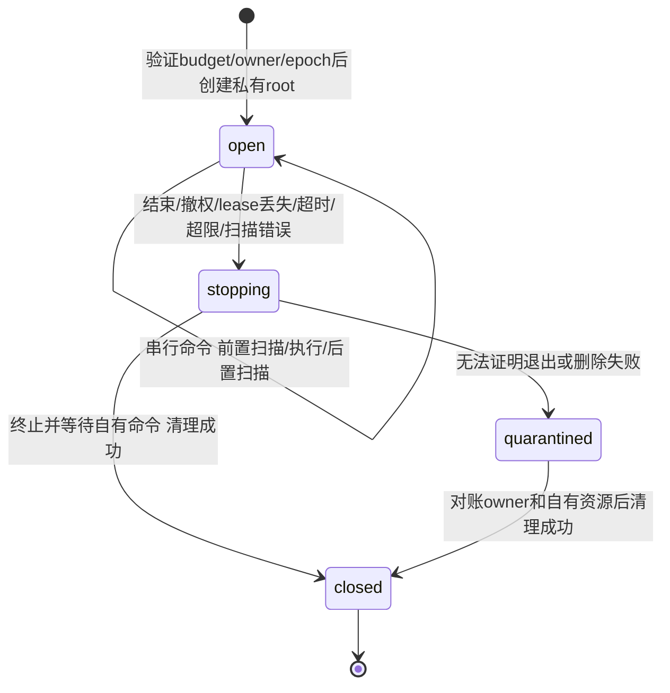

# 原生仓库资源与工作区合同（F2设计稿）

2026-10-16；codex/sidebar-workflow。输入：Confirmed requirements.md（REQ-007/012/020/023、AC-007/018/021）、repository-budget-contract.md、repository-api-diff-contract.md、repository-recovery-implementation-plan.md S4，以及35a2285的真实资源实验。本稿为待审技术设计，不是已实现能力或完整S4批准。

追踪：资源实验35a228593dc3ec33dd3578aedc4b24a4127fe302的[CI38850590219](https://github.com/Ed1s0nZ/AIMergeBot/actions/runs/38850590219)已实际查询completed/success（2026-10-16）；该CI不执行隔离C/Docker实验，实测依据仍为repository-git-resource-research.md。新LCS候选的研究代码/设计接线不由此获得完整生产批准。

## Workflow / Maintainability / Lifecycle Gate

P6/F2，用户问题是跨仓取数不能无限放大资源，也不能把监控阈值宣传成硬隔离。已有逐命令取消、共享网络预算合同和Linux/Darwin能力证据；缺完整factory/网络gate和生产集成验证。允许设计，不允许本稿直接启动生产修改。既有Runner/GitRepository多职责，资源会话与扫描/监督独立成模块，原编排只委托，不加shell拼接和进程内setrlimit。低耦合文档变更无需先重构；未来实现属high风险，须按完整S4审查。

## 决策：基础保护加平台增强，不强求不存在的统一硬沙箱

保留默认Git完整工具链与API-only模式；语言、provider和跨项目目标不变。已确认需求要求预算缺口诚实呈现，没有要求自行构建所有OS的硬资源沙箱。正式基础保护由固定输入/输出上限、共享网络账本、独占工作区、同步检查、运行中监控和wall deadline组成。它不承诺整个宿主不会OOM、磁盘绝不超阈值或恶意Git实现无法逃逸。支持环境有成熟逐进程限额时增强，实际能力如实诊断。

Linux容器仍是现有部署方式之一，不强制所有用户改用Linux/Docker。应用容器的memory/pids/CPU配置属于整服务资源，不等于每run隔离；本稿不让服务取得Docker socket、root或cgroup写权限。无需新增菜单或自动下载launcher。

## 对象和字段边界

本稿暂不提出新增持久表或产品设置，不引入“资源已隔离”布尔权限。沿用schema3预算根、当前worker owner/lease及session_epoch；工作区是其短期资源。跨重启的root所有权回执尚未定案，不能由这句话推断仅内存状态已经足够。以下为拟议内部对象，尚未实现：

| 对象/字段 | 类型/必须/来源 | 所有者、校验及兼容 |
| --- | --- | --- |
| resourceSession.budget_id/run_id/epoch | string/int64/int64，必填 | 只能由已验证budget session创建；不从URL/body获得 |
| resourceSession.root | private绝对路径，必填 | server-owned父目录下MkdirTemp，权限0700；不接受仓库名/path作为本机root；不进DTO/trace |
| resourceSession.state | open/stopping/closed/quarantined | 创建至cleanup的唯一状态机；同session仅一个可运行的Git命令 |
| workspaceThresholdBytes | int64，必填 | 冻结policy.Git.MaxPackMiB×1048576，全部target/source/context子仓共用；合法范围沿现有16–4096MiB；含临时pack/index/全部普通文件 |
| workspaceEntryLimit | int，固定50000 | 整个session全部目录和文件计数，非每repo；达到上限仍需证明EOF，再有条目即失败。v51实现常量，不允许客户端override |
| commandWallLimit | duration，min(30s,剩余run deadline) | 沿既有30s；同一次worker尝试的deadline不因命令或仓库延长；自动child沿预算合同共享网络消耗，不冒称整条retry链已有共同wall deadline |
| outputLimit/stderrLimit | int，8MiB/4096 bytes | 沿既有逐命令；溢出命令失败且停止消费，不返回截断成功 |
| monitorInterval/scanDeadline | duration，100ms/min(2s,剩余run deadline) | 采样调度与单次扫描超时；不是承诺每100ms必定检出超限 |
| capabilityReport | 只含有限平台/模式/能力字段 | 运行时事实，不是授权；基线monitored、可增强linux_rlimit；不含真实path/argv/凭据 |

常量是v51执行合同的一部分，未来更改需新policy版本/兼容决策；不能在同版本热改并声称旧run使用同一资源语义。network charged与workspace observed是两类量，不把删除文件当网络退款，也不把MaxPackMiB同时宣传为精确pack流量和展开体积硬cap。API-only同样有输入/缓存/输出边界，但不创建Git目录或启动Git。

## 所有权、并发与生命周期

- 一个budget执行session拥有一个root，内部每repo用随机内部名分目录。全部仓库串行运行Git命令，不让多个git/index-pack同时放大同run资源；HTTP账本parallel_requests=2是不同约束，不授权第二个Git进程组。
- command使用原有限参数构造、独立进程组及受限环境；不执行checkout、hooks、submodule递归、filters、external diff、仓库脚本或任意helper。参数只来自受控operation和严格对象/路径，不给模型一个shell命令入口。网络仍必须经过独立正式gate，资源监督不能替代网络保护。
- 前后校验原budget/owner/epoch/全部ACL/凭据fence。返回stdout/更新cache/写最终结果前完成后置扫描及fence；不能先把输出交给模型再发现已撤权或磁盘超限。
- 停止后先拒绝新命令并关本session网络route，再取消/等待自有命令及监督任务，之后删除自有root。cleanup可重复；删除失败记录有限code并隔离该root，不吞错、不计为成功释放。
- 自动retry仍用原网络账本；新epoch不复用旧root，也不能以清理为由退款。旧epoch不能继续读/返回输出/清理新root。上一个root未清理可追踪为隔离遗留，不得隐形排除在宿主容量检查之外。
- 多worker并发各有root；不能用每run阈值推导整宿主配额。启动及新session前对账自有root：不删除仍有有效worker实例/epoch的目录；确认过期后清理。若同机旧任务是否仍活着不可判定，保留隔离，不按目录年龄盲删。具体receipt/本机owner对账随S4 worker装配实现，不给任意文件名授予清理权限。

## 工作区扫描、异常与容量

扫描只遍历自身0700工作区，流式读取目录项，不先全量ReadDir；计数用checked int64，大小按普通文件logical st_size求和（不是物理块/RSS）。不跟随symlink；遇到symlink、非预期特殊文件、越界路径、权限/IO错误或条目超限即停止session，不忽略Walk错误后返回偏小数字。hard link不提供折扣，按每个路径计大小。没有checkout，远端文件名不会变成本机工作树路径。

命令开始前同步扫描；命令运行中监督扫描；命令退出后再同步扫描。扫描逐步检查context和2s deadline，失败/超时导致命令取消与结果拒绝。监控协程必须join；不使用另开不可取消扫描goroutine后遗留计算的“超时返回”。OS阻塞IO仍可能延长结束，不能承诺绝对2s或磁盘物理硬cap。

阈值为检测后停止，不是写前预留；快速写入、pack展开或扫描间隔可超过阈值。诊断和覆盖文案必须写“工作区阈值监控”，不能写“最多使用X MiB”。阈值/扫描失败时已经合法取得的证据可以保存为部分结果，但不得当作完整成功。裸git错误正文不返回。

新session创建前检查临时卷容量及自有root遗留。若可用容量不足以容纳当前冻结阈值加64MiB余量则拒绝本次Git准备并给明确容量错误；这是准入检查，不是容量reservation，其他应用/并发run仍可能消耗空间。禁止无条件重试ENOSPC或自动切换未配置磁盘；API-only不因没有Git空间而启动Git或改变原审计模式。跨平台容量检查实现不可用时应给明确诊断并拒绝新Git准备，不把错误当无限空间；已存在legacy行为不在本稿中暗改。

## 平台增强：Linux逐进程限制

候选使用发行版util-linux的固定可信prlimit绝对路径，仅包裹Git子进程；不对Go服务调用setrlimit，不用root/CAP_SYS_RESOURCE，不设置按UID计数的NPROC或无效RSS限制。正式镜像若采用此profile，Dockerfile显式安装并验证依赖；不从PATH自动执行未知wrapper。

提案：AS=512MiB，CPU soft=hard=min(30,向上取整剩余run秒数)，FSIZE=workspaceThresholdBytes，NOFILE=min(256,继承hard值)，CORE=0。它们分别约束单进程虚拟地址空间、CPU、单文件、FD和core；多个helper的总RAM/CPU、全部文件仍不受单进程限额等价保护。512MiB为待压力验证的兼容值，实验只证明256MiB下小型Git正常，不能由此声称正式候选值对大pack足够。

profile在启动受控能力诊断后确定并记录；若宣称启用linux_rlimit，wrapper缺失/不可执行、限制设置失败或能力不符必须拒绝操作，不在错误后静默重试无保护命令。基线monitored不伪装linux_rlimit。Darwin已观察AS不生效、CPU hard不可靠，第一版不声称等价增强；保留已验证进程组wall取消和基础监控。其他OS依实际执行/cancel能力与测试给诊断，本稿没有证明Windows进程树回收，不据此宣布整个产品只支持Linux。

平台增强状态不能修改run冻结额度；历史v50不回填新的硬限额证据。服务整体容器约束可以增加宿主保护，但不会因此变成“每次审计512MiB”。若未来确需强group资源隔离，另设计独立worker/cgroup/quota，不能为了满足未提出的完美隔离目标拖延所有provider接线。

## API文本匹配的明确边界

API模式维持每侧256KiB/2000行、hunk512KiB/文件与整次8MiB、受限cache以及总run deadline。原go-difflib不能中途ctx取消；d8948ce有界LCS探针已证明可逐DP row取消、4M cells/单file及共享32M cells的局部上限，F2转用该候选，具体见API diff与budget合同。资源session的Git子进程取消不适用于Go内存中的匹配，不能以监控或不可回收goroutine冒充保护。正式adapter、持久额度/重启继承及所有consumer仍需实现验收；不能把探针当API-only已经完成。

## 错误、覆盖和恢复

内部拟定有限分类：workspace_threshold_exceeded、workspace_scan_unavailable、workspace_capacity_unavailable、workspace_cleanup_pending、git_process_limit_exceeded、git_resource_profile_unavailable。必须经factory→Runner结果/coverage→DTO/TS→详情/检查/导出/测试完整传播，不能只增枚举。

超限/未知扫描/无法启动固定对象读取：没有完整固定差异时失败；已有部分可信结果但有可定位缺口时按现有incomplete协议处理。不能失败后回退未受限Git、动态API分支或悄悄给新额度。用户修正容量/环境后可明确新run；自动retry不能把环境问题变成无限循环，细分类与现有retry白名单一起审查。cleanup pending留运维诊断，不制造“远端安全”结论。

## 实施交接与必需证据

完整S4计划须将resource_session/scan/process独立模块接入正式factory、Git命令和所有消费者，避免闲置模块先落生产。既有gitCommand供legacy/standalone使用的兼容边界单列，未经迁移验证不把native资源规则偷偷施加于历史任务。默认Docker依赖变化、schema3预算规则、v51严格policy解析、启动能力诊断、回收和前端文案一起审查。

待执行验证：

1. 实际Git合成两格式、target/source/4context共用root；逐命令前后与运行中超限均停止；所有临时文件计入，删除不退网络预算；并发worker不串root。
2. 扫描权限错误、目录项上限、符号链接/特殊文件、取消与整数边界；慢扫描join和错误路径不得输出部分成功；扫描启动/退出后零遗留监控。
3. 旧epoch、lease过期、撤权、删除失败、进程仍活着、应用重启：禁止删新root/活跃其他worker，遗留可诊断；容量不足时零Git fetch，不重试无限循环。
4. Linux正式wrapper带实际Git、所需最大输入和可控资源触发反例；无wrapper/假wrapper/设置失败零无保护重跑。Darwin诊断保留能力差异，不把supervisor kill算hard CPU。
5. API-only运行命令计数为零；matcher对抗性边界独立验收；所有gap/state在详情、导出和阻断规则保持一致。

目前只有35a2285隔离能力实验已完成，上述集成测试均未运行。完整网络gate/API matcher与GitLab协议证据仍需关闭；本资源稿不授权生产实现、开放绑定、合并main、部署或真实外部动作。

## F3前必须关闭的开放项

| 项目 | 现在可确定的事实 | 必须补齐的交接内容 |
| --- | --- | --- |
| 跨重启工作区所有权 | 现有worker lease只证明DB写授权，过期不证明OS子进程已退出 | root→budget/run/epoch/实例的持久回执、文件系统与DB先后顺序、崩溃窗口及自有进程退出证明；不能凭过期lease或PID数字盲删/杀进程。该内容在完整S4方案定案，必要时明确schema3新增对象，不伪称本稿已有完整恢复实现 |
| Linux增强额度/装配 | 实验中256MiB/2s的小型Git成功；正式512MiB/30s仅提案 | 正式支持版本、可信wrapper路径/诊断协议和大输入兼容验证；不能把实验小值直接当可交付默认 |
| API matcher CPU/ctx | d8948ce的有界LCS已验证可取消及共享工作量，旧库保持对照 | 正式adapter及根预算预扣、并发串行、重启/retry传承和coverage传播；局部probe不是生产CPU硬quota |
| 公开反馈传播 | 当前结果有Notes/coverage，但新有限错误尚未接线 | 明确现有结果字段与失败/partial映射、TS文案、检查规则及导出消费者；不能只增加code字符串 |

责任人为S4设计/实现者；全部在生产开发前完成。当前草稿明确选择监控基线，消除“所有OS必须先造完硬沙箱”的非需求阻塞；仍保留会影响正确执行与清理的真实阻塞，不静默替开发者做未验证决定。

## 来源与边界

- [Linux getrlimit](https://man7.org/linux/man-pages/man2/getrlimit.2.html)：rlimit的单进程语义、AS/CPU/FSIZE/NOFILE、继承与权限；支持上文边界，具体候选额度为本项目设计，不是官方推荐值。
- [Docker resource constraints](https://docs.docker.com/engine/containers/resource_constraints/)：容器资源控制需显式配置，整容器保护不证明每run配额；本稿未执行生产部署。
- [本机实验记录](repository-git-resource-research.md)：Darwin/Linux实际观察，不能扩大到所有平台或恶意pack场景。
